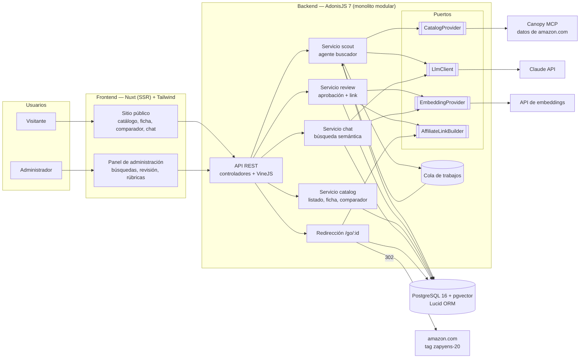
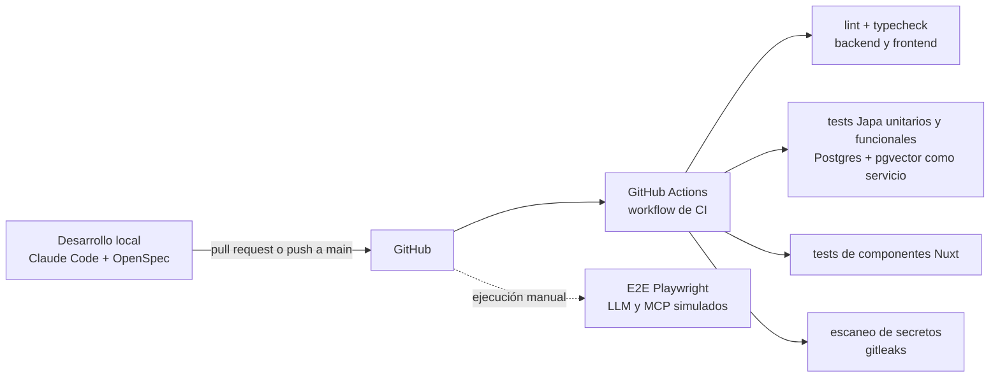
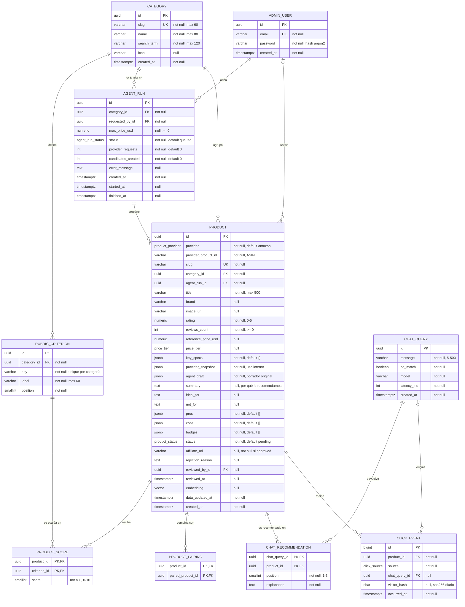

## Índice

0. [Ficha del proyecto](#0-ficha-del-proyecto)
1. [Descripción general del producto](#1-descripción-general-del-producto)
2. [Arquitectura del sistema](#2-arquitectura-del-sistema)
3. [Modelo de datos](#3-modelo-de-datos)
4. [Especificación de la API](#4-especificación-de-la-api)
5. [Historias de usuario](#5-historias-de-usuario)
6. [Tickets de trabajo](#6-tickets-de-trabajo)
7. [Pull requests](#7-pull-requests)

---

## 0. Ficha del proyecto

### **0.1. Tu nombre completo:**

Josue Barrios

### **0.2. Nombre del proyecto:**

AI Shopping Advisor

### **0.3. Descripción breve del proyecto:**

Tienda de productos recomendados: un agente de IA busca productos de un tema (en el MVP, artículos de escritorio
y home office), un administrador decide cuáles se publican y explica por qué los recomienda, y los visitantes
navegan el catálogo como en cualquier e-commerce. La compra se hace en Amazon mediante un link de afiliado que
genera comisión.

### **0.4. URL del proyecto:**

No desplegado: el MVP es una demo que se ejecuta en local (ver 1.4 y 2.4).

### 0.5. URL o archivo comprimido del repositorio

https://github.com/coffmkr/ai-shopping-advisor

---

## 1. Descripción general del producto

### **1.1. Objetivo:**

**Problema.** Elegir un producto en Amazon es abrumador: miles de opciones, anuncios patrocinados mezclados con
los resultados y reseñas difíciles de comparar. Quien vive fuera de EE. UU. (el público inicial es Perú) además
paga envío internacional, así que equivocarse cuesta más.

**Solución.** Una tienda con un catálogo ya filtrado: solo productos seleccionados de la categoría, cada uno con
una **ficha de recomendación** (por qué lo recomendamos, para quién es, pros y contras, nota del asesor por
criterio) y un **comparador** entre productos de la misma categoría. Ese es el valor del producto: el visitante no
ve miles de opciones, ve pocas, bien justificadas y fáciles de comparar. Un agente de IA hace el trabajo de
búsqueda, filtrado y primer borrador, y una persona garantiza la calidad de lo que se publica.

**Para quién.**
- **Cliente (visitante):** quiere comprar algo para su escritorio sin investigar durante horas.
  *Hace:* navega las categorías, abre el detalle de un producto y compara opciones, como en cualquier e-commerce;
  si tiene dudas, pregunta al asistente en lenguaje natural.
  *Recibe:* productos ya seleccionados con su ficha de recomendación, una comparación lado a lado, respuestas del
  asistente basadas solo en el catálogo y un botón hacia Amazon para comprar.
- **Administrador (dueño del sitio):** quiere un catálogo curado sin buscar producto por producto.
  *Introduce:* una categoría y un precio máximo. *Recibe:* candidatos con datos y un borrador de la ficha
  redactado por el agente, que revisa, ajusta y aprueba.
- **Agente buscador (IA):** el actor automático que busca y propone.

**Modelo de negocio.** Comisión de afiliado de Amazon Associates por cada compra que llega desde el sitio
(cuenta creada, tag `zapyens-20`).

### **1.2. Características y funcionalidades principales:**

Cinco funcionalidades imprescindibles (*must-have*):

| # | Funcionalidad | Actor |
|---|---|---|
| 1 | **Agente buscador.** Busca productos de una categoría vía el MCP de Canopy, descarta patrocinados, variantes y productos fuera de precio, y deja candidatos en una cola con un **borrador de la ficha de recomendación** (ver abajo). | Agente IA (lanzado por el administrador) |
| 2 | **Revisión, aprobación y link de afiliado.** Panel autenticado para aprobar o rechazar candidatos. Antes de aprobar, el administrador revisa y edita la ficha de recomendación que redactó el agente. Al aprobar, el sistema genera el link de afiliado con el tag propio; cada clic hacia Amazon pasa por `/go/{id}`, que lo registra antes de redirigir. | Administrador / Sistema |
| 3 | **Catálogo público con ficha de recomendación.** Como cualquier e-commerce: categorías, listado y detalle de cada producto aprobado. El detalle muestra la ficha completa, el botón "Ver en Amazon" y el aviso de afiliado. | Cliente |
| 4 | **Comparador por categoría.** El cliente elige de 2 a 4 productos de la misma categoría y los ve lado a lado: nota del asesor por criterio, especificaciones clave, pros y contras, para quién es cada uno, rango de precio y etiquetas. | Cliente |
| 5 | **Asistente conversacional.** Un chat donde el cliente pide recomendaciones o hace preguntas en lenguaje natural ("algo para que no me duela el cuello con la laptop"). Responde solo con productos del catálogo aprobado, usando búsqueda semántica (pgvector) sobre sus fichas. Si nada encaja, lo dice y guarda el pedido como demanda no cubierta. | Cliente |

**La ficha de recomendación** es lo que ofrece el producto: no solo qué comprar, sino por qué y para quién.
El agente redacta un borrador de cada bloque y el administrador lo revisa:

| Bloque | Ejemplo | Origen |
|---|---|---|
| Por qué lo recomendamos | "El soporte más estable de su rango; eleva la pantalla a la altura de los ojos." | Agente + administrador |
| Ideal para / No es para ti si… | Ideal para home office diario con laptop de 13–16". No es para ti si necesitas llevarlo en la mochila. | Agente + administrador |
| Pros y contras | ✔ Aluminio, sin vibración · ✘ No es plegable | El agente resume las reseñas con palabras propias, sin copiarlas |
| Nota del asesor por criterio | Ergonomía 9/10 · Construcción 9/10 · Portabilidad 4/10 · Calidad-precio 8/10 | Rúbrica definida por categoría; el agente propone, el administrador confirma |
| Especificaciones clave | Material, peso, compatibilidad, rango de altura | Datos del producto vía Canopy, normalizados |
| Etiquetas | "Mejor valorado", "Mejor calidad-precio", "Opción premium", "Elección del asesor" | Administrador (algunas calculadas) |
| Rango de precio | $ · $$ · $$$ | Calculado del precio de referencia (no se muestra el precio exacto de Amazon) |
| Alternativas | "¿Algo más barato?" · "¿Algo más premium?" | Otros productos aprobados de la misma categoría |
| Combina bien con | Soporte de laptop + teclado mecánico + desk pad | Administrador (venta cruzada entre categorías) |
| Revisado el… | "Revisado por el equipo el 22/10/2026" | Fecha de aprobación |

**El MVP tiene dos flujos independientes:**
1. **Curaduría (interno, asíncrono):** el administrador lanza una búsqueda → el agente crea candidatos con el
   borrador de la ficha → el administrador revisa la ficha y aprueba → el producto se publica. Ocurre con
   anticipación; el cliente nunca espera por este flujo.
2. **Compra (cliente, en tiempo real):** el cliente navega las categorías, compara productos o pregunta al
   asistente → abre el detalle → hace clic en "Ver en Amazon" → se registra el clic y Amazon atribuye la venta al
   tag. El catálogo, el comparador y el asistente trabajan sobre la base de datos (fichas aprobadas y sus
   embeddings), sin llamar al agente buscador ni a Amazon; el asistente solo llama al modelo de IA para redactar
   la respuesta.

**Fuera del MVP (evolución prevista):**
- **CRM de demanda no cubierta:** pantalla para que el administrador vea los pedidos sin respuesta del asistente,
  los agrupe por tema y lance búsquedas del agente cuando haya demanda (en el MVP solo se registran).
- **Comparación entre plataformas:** el mismo producto en distintas tiendas (AliExpress, Mercado Libre) y
  comparación entre categorías distintas.

### **1.3. Diseño y experiencia de usuario:**

Pantallas previstas (los mockups y el video se agregarán con la implementación):

**Sitio público (cliente):**
1. **Inicio:** las categorías de la tienda (soportes para laptop, soportes para celular, teclados mecánicos,
   desk pads) y algunos productos destacados.
2. **Categoría:** listado de productos aprobados en tarjetas con imagen, título, nota del asesor, etiquetas,
   rango de precio y el resumen de por qué lo recomendamos. Cada tarjeta tiene una casilla "Comparar".
3. **Detalle de producto:** imagen del producto y la ficha de recomendación completa (por qué lo recomendamos, ideal para / no es para
   ti, pros y contras, nota por criterio, especificaciones, etiquetas, rango de precio, alternativas, combina bien
   con y fecha de revisión) y el botón "Ver en Amazon".
4. **Comparador:** tabla lado a lado de 2 a 4 productos de la misma categoría, con la imagen de cada uno en la
   cabecera, una fila por criterio y
   resaltando el mejor en cada fila; cada columna tiene su botón "Ver en Amazon".
5. **Asistente (chat):** botón flotante en todas las páginas; responde con hasta 3 tarjetas de productos del
   catálogo, cada una con la explicación de por qué encaja con el pedido y el enlace a su ficha.
6. El aviso de afiliado aparece al pie de todas las páginas.

**Panel de administración:**
7. **Login de administrador.**
8. **Búsquedas del agente:** elegir categoría y precio máximo, lanzar y ver el estado (`queued` → `completed`).
9. **Cola de revisión:** lista de candidatos con datos del proveedor y el borrador de la ficha; el administrador
   edita cada bloque y luego "Aprueba" (por qué lo recomendamos y nota por criterio obligatorios) o "Rechaza".
10. **Rúbricas por categoría:** los criterios de la nota del asesor (por ejemplo, para soportes de laptop:
   ergonomía, construcción, portabilidad y calidad-precio).

Las imágenes de producto se obtienen del proveedor de datos (Canopy) y se muestran en tarjetas, detalle y
comparador. El MVP es una demo que no se publica en producción; el prototipo de viabilidad ya mostró el flujo
agente → tarjetas con imágenes y datos reales (`docs/viabilidad/02-amazon-canopy.md`).

### **1.4. Instrucciones de instalación:**

Se completarán con el código. Previsto, con atajos en un `Makefile`:

1. `cp backend/.env.example backend/.env` y `cp frontend/.env.example frontend/.env`, y completar las variables
   (ninguna clave real se sube al repositorio).
2. `make setup` (solo la primera vez): instala dependencias, levanta PostgreSQL 16 + pgvector con Docker
   Compose (una base de desarrollo y otra de pruebas), corre las migraciones y la semilla (categorías, rúbricas,
   administrador de prueba y productos de ejemplo grabados, sin llamar a Canopy).
3. `make start`: backend AdonisJS en `http://localhost:3333` y frontend Nuxt en `http://localhost:3000`.
4. `make test` (unitarios y funcionales del backend, componentes del frontend) y `make test-e2e` (Playwright).

### **1.5. Validación de viabilidad (previa a esta documentación)**

Antes de diseñar se probaron proveedores con servicios reales, buscando descartar y no confirmar:

| Proveedor | Resultado | Evidencia |
|---|---|---|
| Affiliate.com vía ZeroClick | **Descartado.** Catálogo y autenticación funcionan, pero los links no llevan el ID de afiliado propio (`affiliate_id=@@@`) y el parámetro `networks` no tuvo efecto. | `docs/viabilidad/01-affiliate-zeroclick.md` |
| Amazon (datos por MCP de Canopy + Amazon Associates) | **Elegido.** Conexión por MCP, datos suficientes y 12 links generados con el tag propio. Hallazgo: Canopy devuelve URLs con un tag ajeno, así que el link se construye en el sistema. | `docs/viabilidad/02-amazon-canopy.md` |
| AliExpress Portals | Viable según su documentación oficial; pendiente de aprobación de credenciales. Candidato a segundo proveedor. | — |

Riesgos de negocio conocidos: Amazon exige 3 ventas en 180 días, no permite mostrar fotos ni precios sin su API
oficial, y el cobro desde Perú requiere cheque o una cuenta en EE. UU.

---

## 2. Arquitectura del Sistema

### **2.1. Diagrama de arquitectura:**



**Patrón:** monolito modular con arquitectura hexagonal (puertos y adaptadores) sobre las convenciones de
AdonisJS. Cada funcionalidad es un servicio y toda dependencia externa está detrás de un puerto.

**Por qué:**
- Un solo backend y una sola base de datos: adecuado para un MVP de una persona.
- Los proveedores son intercambiables: Canopy hoy, la API oficial de Amazon o AliExpress mañana, con un
  adaptador nuevo y sin tocar los servicios.
- Testeable: en los tests los puertos usan adaptadores falsos o respuestas grabadas, sin llamar a servicios
  externos ni gastar cuota.
- Backend con un stack ya conocido por el autor (AdonisJS, Lucid, Japa), que trae de serie autenticación,
  validación, ORM, tests por HTTP y generación de OpenAPI.
- Nuxt con renderizado en el servidor: el catálogo, las fichas y el comparador llegan ya armados al navegador
  (más rápido y mejor para SEO que una SPA), y el framework es el que mejor domina el autor, lo que permite
  revisar con criterio el código que genera la IA.

**Sacrificios:** no escala por módulo de forma independiente; dos aplicaciones (Nuxt y AdonisJS) en lugar de
una; la cola sobre PostgreSQL rinde menos que una dedicada. Aceptables para el volumen del MVP.

### **2.2. Descripción de componentes principales:**

| Componente | Tecnología | Responsabilidad |
|---|---|---|
| Sitio público | Nuxt (Vue) con SSR + Tailwind CSS, componentes propios | Inicio, categorías, ficha de recomendación, comparador, chat y aviso de afiliado |
| Panel de administración | Mismo proyecto Nuxt, rutas protegidas | Lanzar búsquedas, cola de revisión con editor de la ficha, rúbricas por categoría |
| API REST | AdonisJS 7: controladores, validación con VineJS, auth por sesión, Shield, OpenAPI con `@foadonis/openapi` | Entrada HTTP, sesiones del administrador, orquestación de servicios |
| Servicio scout (agente buscador) | Cola de trabajos + `CatalogProvider` + `LlmClient` (`claude-sonnet-5-5`) | Busca en Canopy, filtra en código (patrocinados, precio, variantes), obtiene especificaciones y reseñas, y pide al LLM el borrador de la ficha y las notas por criterio |
| Servicio review | Lucid + `AffiliateLinkBuilder` + `EmbeddingProvider` | Aprueba o rechaza; al aprobar guarda la ficha, genera el link de afiliado y el embedding |
| Servicio catalog | Lucid | Listado por categoría, ficha, alternativas (misma categoría, otro rango de precio) y comparador |
| Servicio chat | pgvector + `LlmClient` (`claude-haiku-5-5`) | Recupera las 10 fichas aprobadas más cercanas al pedido; el LLM elige hasta 3 y explica; valida los IDs; registra la demanda no cubierta |
| Redirección `/go/:id` | `AffiliateLinkBuilder` | Registra el clic y redirige a `https://www.amazon.com/dp/{ASIN}?tag={AMAZON_TAG}` |
| `CanopyCatalogProvider` | Cliente MCP propio (Streamable HTTP) | `search_amazon_products`, `get_amazon_product` y `get_amazon_product_top_reviews` en `https://mcp.canopyapi.co/mcp` |
| Base de datos | PostgreSQL 16 + pgvector, Lucid ORM | Productos, fichas, notas, rúbricas, búsquedas, clics, consultas del chat y embeddings |

**Stack tecnológico:** TypeScript · AdonisJS 7 (Lucid, VineJS, Auth, Shield) · PostgreSQL 16 + pgvector ·
Nuxt (Vue) + Tailwind CSS · Claude API (Anthropic SDK) · Canopy MCP · Japa · Vitest + `@nuxt/test-utils` ·
Playwright · Docker Compose · Makefile · GitHub Actions · OpenSpec · Claude Code.

### **2.3. Descripción de alto nivel del proyecto y estructura de ficheros**

```
ai-shopping-advisor/
├── README.md                     # Esta documentación
├── prompts.md                    # Registro del uso de IA
├── CLAUDE.md                     # Reglas del proyecto para el agente (harness)
├── .claude/                      # Hooks (guardrails) y comandos de Claude Code
├── openspec/                     # SDD: specs vigentes y cambios propuestos
├── docs/viabilidad/              # Pruebas de viabilidad con servicios reales
├── Makefile                      # Atajos: setup, start, test, test-e2e
├── docker-compose.yml            # PostgreSQL + pgvector: base de desarrollo y de pruebas
├── backend/                      # AdonisJS 7
│   ├── app/
│   │   ├── controllers/          # Endpoints HTTP: admin, catálogo, comparador, chat y /go
│   │   ├── validators/           # VineJS: entrada de la API y salida del LLM
│   │   ├── models/               # Lucid: Category, Product, AgentRun, ChatQuery…
│   │   ├── services/             # Lógica de negocio: scout, review, catalog, chat
│   │   ├── ports/                # Interfaces de proveedores externos (ver 2.2)
│   │   ├── adapters/             # Implementaciones: canopy, claude, embeddings, amazon
│   │   └── jobs/                 # Trabajo asíncrono del agente buscador
│   ├── database/
│   │   ├── migrations/
│   │   └── seeders/              # Categorías, rúbricas, admin de prueba, productos grabados
│   ├── start/routes.ts
│   └── tests/
│       ├── unit/                 # Reglas puras: link, filtros, rango de precio, validaciones
│       ├── functional/           # API por HTTP contra la base de pruebas
│       └── fixtures/             # Respuestas grabadas de Canopy y Claude
├── frontend/                     # Nuxt
│   ├── pages/                    # index, categoria/[slug], producto/[slug], comparar, admin/…
│   ├── components/               # ProductCard, RecommendationSheet, CompareTable, ChatWidget…
│   ├── composables/              # Acceso a la API
│   └── tests/                    # Tests de componentes (Vitest + @nuxt/test-utils)
└── e2e/                          # Playwright: flujo de curaduría y de compra
```

`backend/` sigue las convenciones de AdonisJS con una capa hexagonal: `services/` contiene la lógica de negocio y
solo depende de `ports/`; `adapters/` implementa los puertos contra servicios reales.

### **2.4. Infraestructura y despliegue**

**CI sí, CD no:** el MVP es una demo local; el despliegue no forma parte del alcance.



- **Local:** Docker Compose con PostgreSQL 16 + pgvector (base de desarrollo y base de pruebas separadas);
  `make start` levanta AdonisJS y Nuxt; `make test` y `make test-e2e` corren todas las pruebas.
- **CI:** un solo workflow de GitHub Actions que se ejecuta en cada pull request y en cada push a `main`: lint,
  typecheck, tests unitarios y funcionales del backend, tests de componentes del frontend y escaneo de secretos.
  Cada pull request muestra si el CI pasó o falló.
- **E2E:** se ejecuta en local con `make test-e2e` y, en GitHub, de forma manual (botón "Run workflow"), para no
  levantar toda la aplicación en cada cambio.
- **Despliegue:** fuera del alcance del MVP. Si en el futuro se publica, los secretos irán en el gestor de
  variables de la plataforma, nunca en el repositorio.

### **2.5. Seguridad**

- **Secretos fuera del repositorio:** `.env` y `secrets/` están en `.gitignore` desde el primer commit; los
  `.env.example` sin valores documentarán las variables; gitleaks en CI.
- **Guardrail de agente (hook de Claude Code):** un hook `PreToolUse` bloqueará que el agente lea,
  edite o suba `.env*` (salvo `.env.example`), `secrets/` y llaves.
- **Integridad del link de afiliado:** se construye en el servidor desde un ASIN validado (`^[A-Z0-9]{10}$`) y el
  tag configurado. Nunca se reutilizan URLs del proveedor de datos, que traen tags ajenos (hallazgo de la
  viabilidad).
- **Inyección de instrucciones:** títulos, reseñas y mensajes del chat se pasan al LLM como datos delimitados; la
  salida del LLM se valida con VineJS y todo ID de producto se comprueba contra la base de datos.
- **Autenticación del administrador:** guard de sesión de AdonisJS, contraseña con hash argon2, cookie
  `httpOnly`, `Secure`, `SameSite=Strict`, protección CSRF con Shield; rutas `/admin/*` protegidas.
- **Abuso:** rate limit en el chat (10 mensajes por minuto por visitante) y límite diario de búsquedas del agente
  para no agotar la cuota de Canopy.
- **Privacidad:** no se guardan IPs ni datos personales; los clics usan como máximo un hash diario no reversible;
  los mensajes del chat se guardan sin datos del visitante.
- **Contenido de reseñas:** los pros y contras se redactan con palabras propias; no se copia texto de reseñas.
- **Programa de afiliados:** aviso de afiliado en toda página con links; sin links de Amazon en contenido
  dirigido a menores de 13 años. El MVP muestra imágenes obtenidas vía Canopy porque es una demo no publicada;
  antes de un lanzamiento en producción, imágenes y precios deben venir de la API oficial de Amazon.

### **2.6. Tests**

Estrategia (TDD: el test que falla es la especificación que recibe el agente; cada criterio de aceptación
de las historias de usuario se convierte en al menos un test):

- **Unitarios (Japa, `backend/tests/unit/`):** `AffiliateLinkBuilder` (formato, ASIN inválido, ignora URLs con
  tag ajeno), filtros del agente (patrocinados, precio máximo, variantes, ASIN inventado), cálculo del rango de
  precio, cálculo de alternativas y validación de la salida del LLM.
- **Funcionales (Japa + `@japa/api-client`, `backend/tests/functional/`):** la API por HTTP contra la base de
  pruebas real, nunca simulada. Ejemplos: aprobar un candidato guarda la ficha, genera link y embedding; el
  comparador rechaza productos de distintas categorías; `/go/{id}` registra el clic y responde 302; un producto
  rechazado da 404; el chat nunca devuelve productos no aprobados.
- **Componentes (Vitest + `@nuxt/test-utils`):** ficha de recomendación, tabla del comparador (resalta el mejor
  por criterio), editor de la ficha en el panel y widget del chat.
- **E2E (Playwright):** curaduría (búsqueda → revisión → aprobación) y compra (categoría → comparador → ficha →
  clic registrado), con Canopy y Claude simulados por respuestas grabadas.
- **Evals de IA:** criterios flexibles en lugar de texto exacto. Agente: 10 búsquedas grabadas (sin patrocinados,
  precio respetado, ficha completa, notas dentro de la rúbrica, ningún ASIN inventado). Chat: 15 preguntas
  (solo productos aprobados, 1 a 3 resultados, pregunta fuera del tema → sin productos y registrada como demanda).
- **Ya implementado en la fase de viabilidad:** pruebas del módulo de autenticación del proveedor descartado
  (renovación de token, concurrencia, errores).

---

## 3. Modelo de Datos

### **3.1. Diagrama del modelo de datos:**



### **3.2. Descripción de entidades principales:**

**Enumerados:** `agent_run_status` = `queued | running | completed | failed`; `product_status` =
`pending | approved | rejected | unpublished`; `product_provider` = `amazon` (se amplía con nuevos proveedores);
`price_tier` = `budget | mid | premium` (se muestra como $, $$, $$$); `click_source` =
`listing | detail | compare | chat`.

**ADMIN_USER** — administradores del sitio.
- `id` (uuid, PK); `email` (varchar 254, not null, unique); `password` (varchar, not null; hash argon2 del
  servicio de hash de AdonisJS); `created_at` (timestamptz, not null).

**CATEGORY** — temas de la tienda; agrupan el catálogo y definen dónde busca el agente.
- `id` (uuid, PK); `slug` (varchar 60, not null, unique, kebab-case); `name` (varchar 80, not null);
  `search_term` (varchar 120, not null; término base para el proveedor); `icon` (varchar 60, null);
  `created_at`.
- Relaciones: 1:N con RUBRIC_CRITERION, AGENT_RUN y PRODUCT.

**RUBRIC_CRITERION** — criterios de la nota del asesor de cada categoría (por ejemplo, ergonomía, construcción,
portabilidad y calidad-precio para soportes de laptop).
- `id` (uuid, PK); `category_id` (FK → CATEGORY, not null, on delete cascade); `key` (varchar 40, not null);
  `label` (varchar 60, not null); `position` (smallint, not null; orden en la ficha y el comparador).
- Restricción: unique (`category_id`, `key`).

**AGENT_RUN** — cada ejecución del agente buscador.
- `id` (uuid, PK); `category_id` (FK → CATEGORY, not null); `requested_by_id` (FK → ADMIN_USER, not null);
  `max_price_usd` (numeric 10,2, null, check ≥ 0); `status` (`agent_run_status`, not null, default `queued`);
  `provider_requests` (int, not null, default 0; requests gastados en Canopy); `candidates_created` (int, not
  null, default 0); `error_message` (text, null; sin datos sensibles); `created_at`, `started_at`, `finished_at`.
- Índice: (`status`, `created_at`).

**PRODUCT** — candidato propuesto por el agente; si se aprueba, se publica con su ficha de recomendación.
- Identidad: `id` (uuid, PK); `provider` (`product_provider`, not null); `provider_product_id` (varchar 20, not
  null; el ASIN, check `^[A-Z0-9]{10}$`); **unique (`provider`, `provider_product_id`)** para no proponer dos
  veces el mismo producto; `slug` (varchar 160, not null, unique; URL pública de la ficha).
- Relaciones: `category_id` (FK → CATEGORY, not null); `agent_run_id` (FK → AGENT_RUN, not null);
  `reviewed_by_id` (FK → ADMIN_USER, null).
- Datos del proveedor: `title` (varchar 500, not null); `brand` (varchar 120, null); `image_url` (varchar 500,
  null); `rating` (numeric 2,1, not null, 0–5); `reviews_count` (int, not null, ≥ 0); `reference_price_usd`
  (numeric 10,2, null; uso interno, no se expone en la API pública); `price_tier` (`price_tier`, null; calculado
  por terciles de precio dentro de la categoría); `key_specs` (jsonb, not null; especificaciones normalizadas,
  p. ej. `{"material":"aluminio","peso":"0,9 kg"}`); `provider_snapshot` (jsonb, not null; respuesta original de
  Canopy, uso interno); `data_updated_at` (timestamptz, not null).
- Ficha de recomendación: `agent_draft` (jsonb, not null; borrador original del agente, para auditar qué cambió
  el administrador); `summary` (text, null; por qué lo recomendamos); `ideal_for` y `not_for` (text, null);
  `pros` y `cons` (jsonb, not null, default `[]`; listas de textos propios); `badges` (jsonb, not null, default
  `[]`; p. ej. `["best_rated","best_value"]`).
- Curaduría: `status` (`product_status`, not null, default `pending`); `affiliate_url` (varchar 300, null);
  `rejection_reason` (text, null); `reviewed_at` (timestamptz, null).
- Checks cuando `status = approved`: `summary` entre 20 y 500 caracteres, `ideal_for`, `not_for` y
  `affiliate_url` no nulos, al menos un pro y un contra.
- Búsqueda semántica: `embedding` (vector, null; se calcula al aprobar, a partir del título y la ficha;
  dimensión según el modelo de embeddings; índice HNSW por similitud coseno).
- Índices: (`category_id`, `status`), (`category_id`, `price_tier`).
- *Alternativas* no se guardan: se calculan como productos aprobados de la misma categoría con otro
  `price_tier`.

**PRODUCT_SCORE** — nota del asesor de un producto en cada criterio de su categoría.
- PK compuesta (`product_id`, `criterion_id`); `product_id` (FK → PRODUCT, on delete cascade);
  `criterion_id` (FK → RUBRIC_CRITERION); `score` (smallint, not null, 0–10).
- Regla: el criterio debe pertenecer a la categoría del producto; al aprobar debe haber una nota por cada
  criterio de la rúbrica.

**PRODUCT_PAIRING** — "combina bien con" (venta cruzada, normalmente entre categorías distintas).
- PK compuesta (`product_id`, `paired_product_id`), ambas FK → PRODUCT; check `product_id <> paired_product_id`.

**CHAT_QUERY** — cada mensaje al asistente. Los que tienen `no_match = true` forman la demanda no cubierta.
- `id` (uuid, PK); `message` (varchar 500, not null); `no_match` (boolean, not null); `model` (varchar 60, not
  null); `latency_ms` (int, not null); `created_at`. No guarda datos del visitante.
- Índice: (`no_match`, `created_at`).

**CHAT_RECOMMENDATION** — productos devueltos en cada respuesta del asistente (N:M entre CHAT_QUERY y PRODUCT).
- PK compuesta (`chat_query_id`, `product_id`), ambas FK; `position` (smallint, not null, 1–3);
  `explanation` (text, not null).

**CLICK_EVENT** — cada clic en "Ver en Amazon".
- `id` (bigint, PK); `product_id` (FK → PRODUCT, not null); `source` (`click_source`, not null: listado, ficha,
  comparador o chat); `chat_query_id` (FK → CHAT_QUERY, null; solo si `source = chat`); `visitor_hash` (char 64,
  null; hash diario no reversible, nunca la IP); `occurred_at` (timestamptz, not null).
- Índice: (`product_id`, `occurred_at`).

---

## 4. Especificación de la API

Tres endpoints principales, uno por cada paso clave del producto. El resto de la API:
`GET /api/categories`, `GET /api/categories/{slug}/products`, `GET /api/products/{slug}` (ficha),
`POST /api/chat`, `GET /api/admin/candidates`, `PUT /api/admin/categories/{id}/rubric` y la redirección
`GET /go/{productId}?src=listing|detail|compare|chat`. La especificación completa se generará con
`@foadonis/openapi`.

```yaml
openapi: 3.1.0
info:
  title: AI Shopping Advisor API
  version: 0.1.0
servers:
  - url: http://localhost:3333
components:
  securitySchemes:
    adminSession:
      type: apiKey
      in: cookie
      name: adonis-session
  schemas:
    Error:
      type: object
      required: [error, message]
      properties:
        error: { type: string, example: validation_error }
        message: { type: string }
    AgentRun:
      type: object
      required: [id, categoryId, status, createdAt]
      properties:
        id: { type: string, format: uuid }
        categoryId: { type: string, format: uuid }
        maxPriceUsd: { type: number, nullable: true }
        status: { type: string, enum: [queued, running, completed, failed] }
        candidatesCreated: { type: integer }
        createdAt: { type: string, format: date-time }
    Sheet:
      description: Ficha de recomendación
      type: object
      required: [summary, idealFor, notFor, pros, cons, scores]
      properties:
        summary: { type: string, minLength: 20, maxLength: 500, description: Por qué lo recomendamos }
        idealFor: { type: string, maxLength: 300 }
        notFor: { type: string, maxLength: 300 }
        pros: { type: array, minItems: 1, maxItems: 5, items: { type: string, maxLength: 120 } }
        cons: { type: array, minItems: 1, maxItems: 5, items: { type: string, maxLength: 120 } }
        scores:
          type: array
          description: Una nota por cada criterio de la rúbrica de la categoría
          items:
            type: object
            required: [criterion, score]
            properties:
              criterion: { type: string, example: ergonomia }
              score: { type: integer, minimum: 0, maximum: 10 }
        keySpecs: { type: object, additionalProperties: { type: string } }
        badges: { type: array, items: { type: string, enum: [best_rated, best_value, premium_pick, editor_choice] } }
        pairedProductIds: { type: array, items: { type: string, format: uuid } }
paths:
  /api/admin/agent-runs:
    post:
      summary: Lanza una búsqueda del agente buscador en una categoría
      security: [{ adminSession: [] }]
      requestBody:
        required: true
        content:
          application/json:
            schema:
              type: object
              required: [categoryId]
              properties:
                categoryId: { type: string, format: uuid }
                maxPriceUsd: { type: number, minimum: 1, maximum: 1000 }
      responses:
        '202': { description: Búsqueda encolada, content: { application/json: { schema: { $ref: '#/components/schemas/AgentRun' } } } }
        '401': { description: Sin sesión de administrador, content: { application/json: { schema: { $ref: '#/components/schemas/Error' } } } }
        '404': { description: Categoría inexistente, content: { application/json: { schema: { $ref: '#/components/schemas/Error' } } } }
        '429': { description: Límite diario de búsquedas alcanzado, content: { application/json: { schema: { $ref: '#/components/schemas/Error' } } } }
  /api/admin/candidates/{id}:
    patch:
      summary: Aprueba un candidato con su ficha (genera el link de afiliado) o lo rechaza
      security: [{ adminSession: [] }]
      parameters:
        - { name: id, in: path, required: true, schema: { type: string, format: uuid } }
      requestBody:
        required: true
        content:
          application/json:
            schema:
              oneOf:
                - type: object
                  required: [action, sheet]
                  properties:
                    action: { const: approve }
                    sheet: { $ref: '#/components/schemas/Sheet' }
                - type: object
                  required: [action]
                  properties:
                    action: { const: reject }
                    reason: { type: string, maxLength: 500 }
      responses:
        '200':
          description: Candidato actualizado; si se aprobó, incluye el link de afiliado y la URL pública
          content:
            application/json:
              schema:
                type: object
                properties:
                  id: { type: string, format: uuid }
                  status: { type: string, enum: [approved, rejected] }
                  slug: { type: string }
                  affiliateUrl: { type: string, nullable: true, example: 'https://www.amazon.com/dp/B08BRCT4JH?tag=zapyens-20' }
                  reviewedAt: { type: string, format: date-time }
        '401': { description: Sin sesión de administrador }
        '404': { description: Candidato inexistente }
        '409': { description: El candidato no está en estado pending }
        '422': { description: Ficha inválida (p. ej. falta una nota de la rúbrica o el resumen es muy corto) }
  /api/compare:
    get:
      summary: Compara de 2 a 4 productos aprobados de la misma categoría
      parameters:
        - name: ids
          in: query
          required: true
          description: IDs separados por coma
          schema: { type: string, example: '0b6f2d4e-…,7a91c3d0-…' }
      responses:
        '200':
          description: Tabla de comparación
          content:
            application/json:
              schema:
                type: object
                required: [category, criteria, products]
                properties:
                  category: { type: object, properties: { slug: { type: string }, name: { type: string } } }
                  criteria:
                    type: array
                    items: { type: object, properties: { key: { type: string }, label: { type: string } } }
                  products:
                    type: array
                    minItems: 2
                    maxItems: 4
                    items:
                      type: object
                      properties:
                        id: { type: string, format: uuid }
                        slug: { type: string }
                        title: { type: string }
                        imageUrl: { type: string, nullable: true }
                        priceTier: { type: string, enum: [budget, mid, premium] }
                        scores: { type: object, additionalProperties: { type: integer } }
                        idealFor: { type: string }
                        pros: { type: array, items: { type: string } }
                        cons: { type: array, items: { type: string } }
                        keySpecs: { type: object, additionalProperties: { type: string } }
                        badges: { type: array, items: { type: string } }
                        goUrl: { type: string, example: '/go/0b6f2d4e-…?src=compare' }
                  bestByCriterion:
                    type: object
                    description: ID del producto con mejor nota en cada criterio
                    additionalProperties: { type: string, format: uuid }
        '404': { description: Algún producto no existe o no está aprobado }
        '422': { description: Menos de 2 o más de 4 productos, o productos de categorías distintas }
```

**Ejemplo — comparador**

```http
GET /api/compare?ids=0b6f2d4e-91a3-4c55-8f1e-6a2b7c9d0e13,7a91c3d0-55e2-4b8a-9c1f-3e4d5a6b7c80
```

```json
{
  "category": { "slug": "soportes-laptop", "name": "Soportes para laptop" },
  "criteria": [
    { "key": "ergonomia", "label": "Ergonomía" },
    { "key": "construccion", "label": "Construcción" },
    { "key": "portabilidad", "label": "Portabilidad" },
    { "key": "calidad_precio", "label": "Calidad-precio" }
  ],
  "products": [
    {
      "id": "0b6f2d4e-91a3-4c55-8f1e-6a2b7c9d0e13",
      "slug": "besign-ls03-soporte-laptop-aluminio",
      "title": "BESIGN LS03 Aluminum Laptop Stand",
      "imageUrl": "https://m.media-amazon.com/images/I/…jpg",
      "priceTier": "mid",
      "scores": { "ergonomia": 9, "construccion": 9, "portabilidad": 4, "calidad_precio": 8 },
      "idealFor": "Home office diario con laptop de 13 a 16 pulgadas.",
      "pros": ["Aluminio, no vibra al escribir", "Eleva la pantalla a la altura de los ojos"],
      "cons": ["No es plegable"],
      "keySpecs": { "material": "aluminio", "compatibilidad": "10–16\"" },
      "badges": ["best_rated"],
      "goUrl": "/go/0b6f2d4e-91a3-4c55-8f1e-6a2b7c9d0e13?src=compare"
    },
    {
      "id": "7a91c3d0-55e2-4b8a-9c1f-3e4d5a6b7c80",
      "slug": "tonmom-soporte-laptop-plegable",
      "title": "Tonmom Laptop Stand, Adjustable Laptop Riser",
      "imageUrl": "https://m.media-amazon.com/images/I/…jpg",
      "priceTier": "budget",
      "scores": { "ergonomia": 7, "construccion": 6, "portabilidad": 9, "calidad_precio": 9 },
      "idealFor": "Quien trabaja en distintos lugares y necesita llevarlo en la mochila.",
      "pros": ["Plegable y liviano", "Muy económico"],
      "cons": ["Menos estable con laptops pesadas"],
      "keySpecs": { "material": "plástico ABS", "compatibilidad": "10–15.6\"" },
      "badges": ["best_value"],
      "goUrl": "/go/7a91c3d0-55e2-4b8a-9c1f-3e4d5a6b7c80?src=compare"
    }
  ],
  "bestByCriterion": {
    "ergonomia": "0b6f2d4e-91a3-4c55-8f1e-6a2b7c9d0e13",
    "construccion": "0b6f2d4e-91a3-4c55-8f1e-6a2b7c9d0e13",
    "portabilidad": "7a91c3d0-55e2-4b8a-9c1f-3e4d5a6b7c80",
    "calidad_precio": "7a91c3d0-55e2-4b8a-9c1f-3e4d5a6b7c80"
  }
}
```

---

## 5. Historias de Usuario

**Historia de Usuario 1 — El agente propone candidatos con su ficha**

> Como **administrador**, quiero **lanzar una búsqueda del agente en una categoría con un precio máximo** para
> **recibir candidatos filtrados con un borrador de ficha, sin buscar producto por producto en Amazon**.

Criterios de aceptación:
- **Dado** que estoy autenticado y existe la categoría "Soportes para laptop" con su rúbrica, **cuando** lanzo una
  búsqueda con precio máximo US$40, **entonces** veo la búsqueda en estado `queued` y luego `completed`.
- **Dado** que la búsqueda terminó, **cuando** abro la cola de revisión, **entonces** veo solo candidatos no
  patrocinados, de hasta US$40 y sin variantes repetidas.
- **Dado** un candidato, **cuando** lo abro, **entonces** trae imagen, especificaciones clave y un borrador de
  ficha: por qué lo recomendamos, ideal para, no es para ti si, pros y contras, y una nota de 0 a 10 por cada
  criterio de la rúbrica.
- **Dado** que un producto ya fue rechazado antes, **cuando** el agente lo vuelve a encontrar, **entonces** no
  aparece de nuevo en la cola.
- **Dado** que Canopy no responde, **cuando** corre la búsqueda, **entonces** queda en `failed` con un mensaje
  claro y sin candidatos parciales.

Prioridad: alta · Estimación: 8 puntos

**Historia de Usuario 2 — El administrador publica la ficha con link de afiliado**

> Como **administrador**, quiero **revisar y ajustar la ficha que redactó el agente antes de aprobar** para
> **publicar recomendaciones en las que confío, con un link que me genere comisión**.

Criterios de aceptación:
- **Dado** un candidato `pending`, **cuando** edito la ficha y lo apruebo, **entonces** queda `approved`, se
  publica en su categoría y su link es `https://www.amazon.com/dp/{ASIN}?tag=zapyens-20`.
- **Dado** que el proveedor devolvió para ese producto una URL con otro tag, **cuando** lo apruebo, **entonces**
  el link guardado no contiene ese tag.
- **Dado** que falta la nota de un criterio de la rúbrica o el resumen tiene menos de 20 caracteres, **cuando**
  intento aprobar, **entonces** veo qué falta y el candidato sigue `pending`.
- **Dado** que cambié el texto del agente, **cuando** apruebo, **entonces** se publica mi versión y el borrador
  original queda guardado.
- **Dado** un candidato que rechacé, **cuando** un visitante abre el catálogo, el comparador o el chat,
  **entonces** no lo ve.

Prioridad: alta · Estimación: 5 puntos

**Historia de Usuario 3 — El cliente compara y decide**

> Como **visitante**, quiero **comparar los productos recomendados de una categoría y ver por qué se recomienda
> cada uno** para **elegir rápido el que mejor encaja conmigo**.

Criterios de aceptación:
- **Dado** que estoy en "Soportes para laptop", **cuando** marco "Comparar" en 2 a 4 productos y abro el
  comparador, **entonces** los veo lado a lado con imagen, nota por criterio, ideal para, pros y contras,
  especificaciones, rango de precio y etiquetas.
- **Dado** el comparador, **cuando** lo veo, **entonces** en cada criterio se resalta el producto con mejor nota.
- **Dado** que intento comparar 1 producto, o más de 4, **cuando** abro el comparador, **entonces** se me indica
  el rango permitido.
- **Dado** que abro la ficha de un producto, **cuando** la recorro, **entonces** veo alternativas más baratas o
  más premium de la misma categoría y productos que combinan bien con él.
- **Dado** el comparador o la ficha, **cuando** hago clic en "Ver en Amazon", **entonces** llego a Amazon y el
  clic queda registrado con su origen (`compare` o `detail`).
- **Dado** cualquier página, **cuando** la veo, **entonces** se muestra el aviso de afiliado.

Prioridad: alta · Estimación: 8 puntos

---

## 6. Tickets de Trabajo

**Ticket 1 — [Base de datos] Esquema inicial, migraciones y semilla**

- **Tipo:** base de datos · **Prioridad:** alta (bloquea al resto) · **Estimación:** 5 puntos
- **Descripción:** crear el esquema de la sección 3 con migraciones de Lucid sobre PostgreSQL 16 + pgvector, con
  base de desarrollo y base de pruebas separadas, y una semilla reproducible.
- **Alcance:**
  1. `docker-compose.yml` con la imagen `pgvector/pgvector:pg16` y dos bases (desarrollo y pruebas) en puertos
     no estándar para no chocar con un PostgreSQL local.
  2. Migraciones de Lucid para las 10 tablas y los 5 enumerados, con `CREATE EXTENSION vector`.
  3. Restricciones: unique (`provider`, `provider_product_id`), unique (`category_id`, `key`) en la rúbrica,
     formato del ASIN, `score` entre 0 y 10, `rating` entre 0 y 5, checks de ficha completa y `affiliate_url`
     cuando `status = approved`, `product_id <> paired_product_id`.
  4. Índices: (`category_id`, `status`), (`category_id`, `price_tier`), (`product_id`, `occurred_at`),
     (`no_match`, `created_at`) y HNSW sobre `embedding`.
  5. Modelos Lucid con sus relaciones.
  6. Semilla: 4 categorías de escritorio con sus rúbricas, un administrador de prueba (contraseña desde `.env`) y
     12 productos aprobados con ficha, a partir de respuestas grabadas (sin llamar a Canopy).
- **TDD — tests primero (Japa contra la base de pruebas real):**
  - Insertar dos productos con el mismo (`amazon`, ASIN) falla por unicidad.
  - Aprobar un producto sin `affiliate_url` o sin `summary` falla por el check.
  - Un ASIN con 9 caracteres falla.
  - Una nota de 11 falla.
  - Un producto no puede combinarse consigo mismo.
  - Borrar una categoría con productos falla por la FK.
  - La búsqueda por similitud devuelve primero el producto con el embedding más cercano.
- **Criterios de aceptación:** `make setup` funciona en una máquina limpia; los tests pasan con `make test`; la semilla no
  llama a servicios externos.

**Ticket 2 — [Backend] Agente buscador: endpoint y trabajo asíncrono**

- **Tipo:** backend · **Prioridad:** alta · **Estimación:** 8 puntos · **Depende de:** Ticket 1 ·
  **Historia:** HU1
- **Descripción:** implementar `POST /api/admin/agent-runs` y el trabajo que busca en Canopy, filtra, obtiene
  especificaciones y reseñas, y pide al LLM el borrador de la ficha de cada candidato.
- **Alcance:**
  1. Puerto `CatalogProvider` y adaptador `CanopyCatalogProvider` (cliente MCP): `search_amazon_products`
     (`domain: US`), `get_amazon_product` y `get_amazon_product_top_reviews`.
  2. Filtros deterministas en código: excluir `sponsored`, sin ASIN, sin precio o valoración, sobre
     `maxPriceUsd`, y variantes con las mismas valoraciones.
  3. `LlmClient` con `claude-sonnet-5-5`: recibe cada producto filtrado (datos, especificaciones y reseñas como
     bloques de datos delimitados) y la rúbrica de la categoría; devuelve JSON con `summary`, `idealFor`, `notFor`,
     `pros`, `cons` (con palabras propias), `scores` por criterio y `keySpecs`. Se valida con VineJS; se
     descartan ASINs que no estaban en la entrada y notas de criterios que no son de la rúbrica.
  4. Trabajo asíncrono con estados `queued → running → completed | failed`, una transacción para los candidatos,
     `agent_draft` guardado tal cual y contador `provider_requests`.
  5. Límite diario de búsquedas (`CANOPY_MAX_SEARCHES_PER_DAY`) → 429.
- **TDD — tests primero:**
  - Unitarios (fixtures grabadas de Canopy): 10 resultados con 3 patrocinados → ningún candidato patrocinado;
    producto de US$64.99 con tope de US$40 → descartado.
  - Unitario: el LLM simulado devuelve un ASIN inventado o un criterio fuera de la rúbrica → se descarta.
  - Funcionales: 202 con sesión; 401 sin sesión; 404 con categoría inexistente; proveedor simulado con error →
    `failed` y 0 candidatos; 429 al superar el límite diario.
  - Eval: 10 búsquedas grabadas cumplen los criterios de HU1 (ficha completa, notas en rango, sin patrocinados).
- **Criterios de aceptación:** todos los criterios de HU1 cubiertos por tests; ningún test llama a Canopy ni a
  Claude reales; la API key nunca aparece en logs.

**Ticket 3 — [Frontend] Comparador por categoría**

- **Tipo:** frontend · **Prioridad:** alta · **Estimación:** 5 puntos · **Depende de:** `GET /api/compare` ·
  **Historia:** HU3
- **Descripción:** página pública de Nuxt que muestra de 2 a 4 productos de una categoría lado a lado y ayuda a
  decidir.
- **Alcance:**
  1. Casilla "Comparar" en `ProductCard` del listado; la selección vive en la URL
     (`/comparar?ids=…`) para que se pueda compartir, y una barra inferior muestra cuántos van (máx. 4).
  2. Página `pages/comparar.vue` renderizada en el servidor con `useFetch` a `GET /api/compare`.
  3. Componente `CompareTable`: cabecera con imagen, título, rango de precio y etiquetas; una fila por criterio de
     la rúbrica con la nota y el mejor resaltado (`bestByCriterion`); filas de ideal para, pros, contras y
     especificaciones; botón "Ver en Amazon" por columna hacia `goUrl`.
  4. En móvil, columnas desplazables horizontalmente con la primera columna fija.
  5. Estados: menos de 2 productos ("Elige al menos 2 productos"), error de la API y carga.
  6. Accesible: tabla con encabezados (`<th scope>`), el resaltado no depende solo del color.
- **TDD — tests primero (Vitest + `@nuxt/test-utils`, API simulada):**
  - Con 3 productos renderiza 3 columnas y una fila por criterio.
  - El mejor de cada criterio tiene la marca de "mejor" (texto o ícono, no solo color).
  - Con 1 producto muestra el mensaje y no la tabla.
  - El botón de cada columna apunta a `/go/{id}?src=compare`.
  - Marcar un quinto producto en el listado queda deshabilitado.
- **Criterios de aceptación:** el E2E de compra pasa por esta página; la página llega renderizada desde el
  servidor (visible sin JavaScript); sin errores de accesibilidad críticos (axe).

---

## 7. Pull Requests

Se documentarán cuando comience la implementación.
