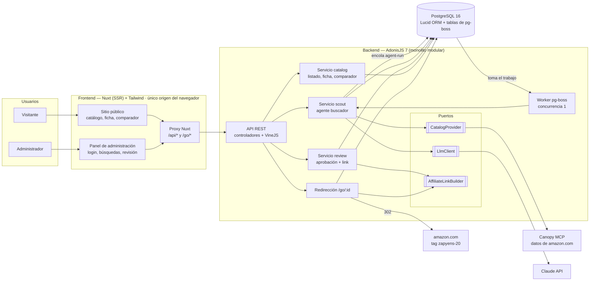
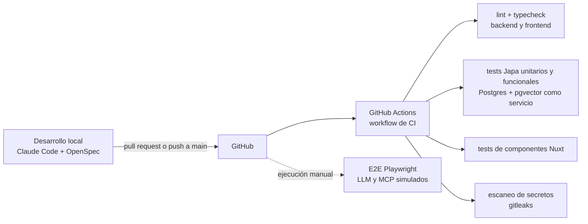
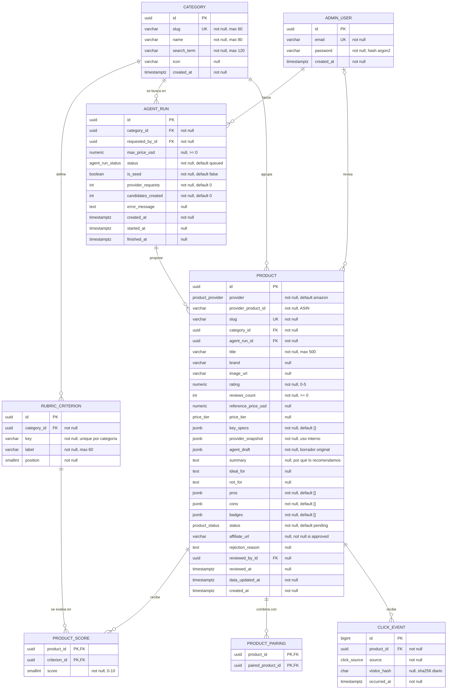

## Índice

0. [Ficha del proyecto](#0-ficha-del-proyecto)
1. [Descripción general del producto](#1-descripción-general-del-producto)
2. [Arquitectura del sistema](#2-arquitectura-del-sistema)
3. [Modelo de datos](#3-modelo-de-datos)
4. [Especificación de la API](#4-especificación-de-la-api)
5. [Historias de usuario](#5-historias-de-usuario)
6. [Tickets de trabajo](#6-tickets-de-trabajo)
7. [Pull requests](#7-pull-requests)

---

## 0. Ficha del proyecto

### **0.1. Tu nombre completo:**

Josue Barrios

### **0.2. Nombre del proyecto:**

AI Shopping Advisor

### **0.3. Descripción breve del proyecto:**

Tienda de productos recomendados: un agente de IA busca productos de un tema (en el MVP, artículos de escritorio
y home office), un administrador decide cuáles se publican y explica por qué los recomienda, y los visitantes
navegan el catálogo como en cualquier e-commerce. La compra se hace en Amazon mediante un link de afiliado que
genera comisión.

### **0.4. URL del proyecto:**

Pendiente: se publicará con la entrega final (ver 2.4). Mientras tanto, se ejecuta en local (ver 1.4).

### 0.5. URL o archivo comprimido del repositorio

https://github.com/coffmkr/ai-shopping-advisor

---

## 1. Descripción general del producto

### **1.1. Objetivo:**

**Problema.** Elegir un producto en Amazon es abrumador: miles de opciones, anuncios patrocinados mezclados con
los resultados y reseñas difíciles de comparar. Quien vive fuera de EE. UU. (el público inicial es Perú) además
paga envío internacional, así que equivocarse cuesta más.

**Solución.** Una tienda con un catálogo ya filtrado: solo productos seleccionados de la categoría, cada uno con
una **ficha de recomendación** (por qué lo recomendamos, para quién es, pros y contras, nota del asesor por
criterio) y un **comparador** entre productos de la misma categoría. Ese es el valor del producto: el visitante no
ve miles de opciones, ve pocas, bien justificadas y fáciles de comparar. Un agente de IA hace el trabajo de
búsqueda, filtrado y primer borrador, y una persona garantiza la calidad de lo que se publica.

**Para quién.**
- **Cliente (visitante):** quiere comprar algo para su escritorio sin investigar durante horas.
  *Hace:* navega las categorías, abre el detalle de un producto y compara opciones, como en cualquier e-commerce.
  *Recibe:* productos ya seleccionados con su ficha de recomendación, una comparación lado a lado y un botón hacia
  Amazon para comprar. (En la ampliación, además, un asistente al que preguntar en lenguaje natural; ver 1.2.)
- **Administrador (dueño del sitio):** quiere un catálogo curado sin buscar producto por producto.
  *Introduce:* una categoría y un precio máximo. *Recibe:* candidatos con datos y un borrador de la ficha
  redactado por el agente, que revisa, ajusta y aprueba.
- **Agente buscador (IA):** el actor automático que busca y propone.

**Modelo de negocio.** Comisión de afiliado de Amazon Associates por cada compra que llega desde el sitio
(cuenta creada, tag `zapyens-20`).

### **1.2. Características y funcionalidades principales:**

**Núcleo del MVP:** cuatro funcionalidades imprescindibles (*must-have*) que cierran de punta a punta el flujo
del administrador (curaduría) y el del visitante (compra). Las rúbricas de cada categoría vienen de la semilla.

| # | Funcionalidad | Actor |
|---|---|---|
| 1 | **Agente buscador.** Busca productos de una categoría vía el MCP de Canopy, descarta patrocinados, variantes y productos fuera de precio, y deja candidatos en una cola con un **borrador de la ficha de recomendación** (ver abajo). | Agente IA (lanzado por el administrador) |
| 2 | **Revisión, aprobación y link de afiliado.** Panel autenticado para aprobar o rechazar candidatos. Antes de aprobar, el administrador revisa y edita la ficha de recomendación que redactó el agente. Al aprobar, el sistema genera el link de afiliado con el tag propio; cada clic hacia Amazon pasa por `/go/{id}`, que lo registra antes de redirigir. | Administrador / Sistema |
| 3 | **Catálogo público con ficha de recomendación.** Como cualquier e-commerce: categorías, listado y detalle de cada producto aprobado. El detalle muestra la ficha completa, el botón "Ver en Amazon" y el aviso de afiliado. | Cliente |
| 4 | **Comparador por categoría.** El cliente elige de 2 a 4 productos de la misma categoría y los ve lado a lado: nota del asesor por criterio, especificaciones clave, pros y contras, para quién es cada uno, rango de precio y etiquetas. | Cliente |

**Ampliación (después del núcleo, si el tiempo lo permite):**

| # | Funcionalidad | Actor |
|---|---|---|
| 5 | **Asistente conversacional.** Un chat donde el cliente pide recomendaciones o hace preguntas en lenguaje natural ("algo para que no me duela el cuello con la laptop"). Responde solo con productos del catálogo aprobado, usando búsqueda semántica (pgvector) sobre sus fichas. Si nada encaja, lo dice y guarda el pedido como demanda no cubierta. Diseño técnico en 3.3. | Cliente |
| 6 | **Editor de rúbricas.** Pantalla del panel para crear y editar los criterios de la nota del asesor de cada categoría. En el núcleo, las rúbricas se cargan desde la semilla. | Administrador |

**La ficha de recomendación** es lo que ofrece el producto: no solo qué comprar, sino por qué y para quién.
El agente redacta un borrador de cada bloque y el administrador lo revisa:

| Bloque | Ejemplo | Origen |
|---|---|---|
| Por qué lo recomendamos | "El soporte más estable de su rango; eleva la pantalla a la altura de los ojos." | Agente + administrador |
| Ideal para / No es para ti si… | Ideal para home office diario con laptop de 13–16". No es para ti si necesitas llevarlo en la mochila. | Agente + administrador |
| Pros y contras | ✔ Aluminio, sin vibración · ✘ No es plegable | El agente resume las reseñas con palabras propias, sin copiarlas |
| Nota del asesor por criterio | Ergonomía 9/10 · Construcción 9/10 · Portabilidad 4/10 · Calidad-precio 8/10 | Rúbrica definida por categoría; el agente propone, el administrador confirma |
| Especificaciones clave | Material, peso, compatibilidad, rango de altura | Datos del producto vía Canopy, normalizados |
| Etiquetas | "Mejor valorado", "Mejor calidad-precio", "Opción premium", "Elección del asesor" | Administrador (algunas calculadas) |
| Rango de precio | $ · $$ · $$$ | Calculado del precio de referencia (no se muestra el precio exacto de Amazon) |
| Alternativas | "¿Algo más barato?" · "¿Algo más premium?" | Otros productos aprobados de la misma categoría |
| Combina bien con | Soporte de laptop + teclado mecánico + desk pad | Administrador (venta cruzada entre categorías) |
| Revisado el… | "Revisado por el equipo el 22/10/2026" | Fecha de aprobación |

**El MVP tiene dos flujos independientes:**
1. **Curaduría (interno, asíncrono):** el administrador lanza una búsqueda → el agente crea candidatos con el
   borrador de la ficha → el administrador revisa la ficha y aprueba → el producto se publica. Ocurre con
   anticipación; el cliente nunca espera por este flujo.
2. **Compra (cliente, en tiempo real):** el cliente navega las categorías o compara productos → abre el detalle →
   hace clic en "Ver en Amazon" → se registra el clic y Amazon atribuye la venta al tag. El catálogo y el
   comparador trabajan solo sobre la base de datos (fichas aprobadas), sin llamar al agente buscador, a Amazon ni a
   ningún modelo de IA.

**Fuera del MVP (evolución prevista):**
- **CRM de demanda no cubierta** (depende del asistente conversacional): pantalla para que el administrador vea los pedidos sin respuesta del asistente,
  los agrupe por tema y lance búsquedas del agente cuando haya demanda (en el MVP solo se registran).
- **Comparación entre plataformas:** el mismo producto en distintas tiendas (AliExpress, Mercado Libre) y
  comparación entre categorías distintas.

### **1.3. Diseño y experiencia de usuario:**

Pantallas previstas (los mockups y el video se agregarán con la implementación):

**Sitio público (cliente):**
1. **Inicio:** las categorías de la tienda (soportes para laptop, soportes para celular, teclados mecánicos,
   desk pads) y algunos productos destacados.
2. **Categoría:** listado de productos aprobados en tarjetas con imagen, título, nota del asesor, etiquetas,
   rango de precio y el resumen de por qué lo recomendamos. Cada tarjeta tiene una casilla "Comparar".
3. **Detalle de producto:** imagen del producto y la ficha de recomendación completa (por qué lo recomendamos, ideal para / no es para
   ti, pros y contras, nota por criterio, especificaciones, etiquetas, rango de precio, alternativas, combina bien
   con y fecha de revisión) y el botón "Ver en Amazon".
4. **Comparador:** tabla lado a lado de 2 a 4 productos de la misma categoría, con la imagen de cada uno en la
   cabecera, una fila por criterio y
   resaltando el mejor en cada fila; cada columna tiene su botón "Ver en Amazon".
5. El aviso de afiliado aparece al pie de todas las páginas.

**Panel de administración:**
6. **Login de administrador.**
7. **Búsquedas del agente:** elegir categoría y precio máximo, lanzar y ver el listado de búsquedas con su estado
   (`queued` → `running` → `completed` o `failed`).
8. **Cola de revisión:** lista de candidatos con datos del proveedor y el borrador de la ficha; el administrador
   edita cada bloque y luego "Aprueba" (por qué lo recomendamos y nota por criterio obligatorios) o "Rechaza".

**Ampliación:** el **asistente (chat)**, un botón flotante en todas las páginas que responde con hasta 3 tarjetas
de productos del catálogo, y la pantalla de **rúbricas por categoría** del panel.

Las imágenes de producto se obtienen del proveedor de datos (Canopy) y se muestran en tarjetas, detalle y
comparador. El MVP es una demo académica, no un lanzamiento comercial; el prototipo de viabilidad ya mostró el flujo
agente → tarjetas con imágenes y datos reales (`docs/viabilidad/02-amazon-canopy.md`).

### **1.4. Instrucciones de instalación:**

Requisitos: Docker y Node 24. Todos los atajos están en el `Makefile` de la raíz.

1. `make setup` (solo la primera vez): crea los archivos de entorno que falten a partir de `.env.example`
   (y la `APP_KEY` del backend), instala dependencias, levanta PostgreSQL 16 con Docker Compose (una base de
   desarrollo y otra de pruebas, en el puerto 55432), corre las migraciones y la semilla. Ninguna clave real se
   sube al repositorio.
2. Completa `CANOPY_API_KEY` en el archivo de entorno de la raíz (y `ANTHROPIC_API_KEY` si quieres que el agente
   redacte fichas en vivo).
3. `make start`: backend AdonisJS en `http://localhost:3333`, worker de la cola (pg-boss) y frontend Nuxt en
   `http://localhost:3000`. Abre `http://localhost:3000`: el navegador solo habla con Nuxt, que reenvía `/api/*`
   y `/go/*` al backend (ver 2.2).
4. `make test`: tests unitarios y funcionales del backend (contra la base de pruebas) y de componentes del
   frontend. `make fresh` recrea la base de desarrollo con la semilla.

### **1.5. Validación de viabilidad (previa a esta documentación)**

Antes de diseñar se probaron proveedores con servicios reales, buscando descartar y no confirmar:

| Proveedor | Resultado | Evidencia |
|---|---|---|
| Affiliate.com vía ZeroClick | **Descartado.** Catálogo y autenticación funcionan, pero los links no llevan el ID de afiliado propio (`affiliate_id=@@@`) y el parámetro `networks` no tuvo efecto. | `docs/viabilidad/01-affiliate-zeroclick.md` |
| Amazon (datos por MCP de Canopy + Amazon Associates) | **Elegido.** Conexión por MCP, datos suficientes y 12 links generados con el tag propio. Hallazgo: Canopy devuelve URLs con un tag ajeno, así que el link se construye en el sistema. | `docs/viabilidad/02-amazon-canopy.md` |
| AliExpress Portals | Viable según su documentación oficial; pendiente de aprobación de credenciales. Candidato a segundo proveedor. | — |

Riesgos de negocio conocidos: Amazon exige 3 ventas en 180 días, no permite mostrar fotos ni precios sin su API
oficial, y el cobro desde Perú requiere cheque o una cuenta en EE. UU.

---

## 2. Arquitectura del Sistema

### **2.1. Diagrama de arquitectura:**



El diagrama muestra el núcleo del MVP. La ampliación (asistente conversacional con embeddings y editor de
rúbricas) se describe en 1.2 y 3.3 y no cambia estas piezas: añade un servicio `chat`, un puerto
`EmbeddingProvider` y un trabajo más en la misma cola.

**Patrón:** monolito modular con arquitectura hexagonal (puertos y adaptadores) sobre las convenciones de
AdonisJS. Cada funcionalidad es un servicio y toda dependencia externa está detrás de un puerto.

**Por qué:**
- Un solo backend y una sola base de datos: adecuado para un MVP de una persona.
- Los proveedores son intercambiables: Canopy hoy, la API oficial de Amazon o AliExpress mañana, con un
  adaptador nuevo y sin tocar los servicios.
- Testeable: en los tests los puertos usan adaptadores falsos o respuestas grabadas, sin llamar a servicios
  externos ni gastar cuota.
- Backend con un stack ya conocido por el autor (AdonisJS, Lucid, Japa), que trae de serie autenticación,
  validación, ORM, tests por HTTP y generación de OpenAPI.
- Nuxt con renderizado en el servidor: el catálogo, las fichas y el comparador llegan ya armados al navegador
  (más rápido y mejor para SEO que una SPA), y el framework es el que mejor domina el autor, lo que permite
  revisar con criterio el código que genera la IA.

- Cola de trabajos con **pg-boss** sobre el mismo PostgreSQL: el agente tarda uno o dos minutos (varias llamadas a
  Canopy y a Claude), así que la petición HTTP responde enseguida con 202 y un worker ejecuta la búsqueda en
  segundo plano, con estados, reintentos y sin infraestructura adicional (sin Redis).
- **Un solo origen para el navegador:** Nuxt reenvía `/api/*` y `/go/*` a AdonisJS (`routeRules` con `proxy`).
  La cookie de sesión `SameSite=Strict` funciona sin CORS, y el renderizado en servidor de Nuxt llama al backend
  por la red interna.

**Sacrificios:** no escala por módulo de forma independiente; dos aplicaciones (Nuxt y AdonisJS) en lugar de
una; la cola sobre PostgreSQL rinde menos que una dedicada (Redis + BullMQ); un salto de red más por el proxy.
Aceptables para el volumen del MVP.

### **2.2. Descripción de componentes principales:**

| Componente | Tecnología | Responsabilidad |
|---|---|---|
| Sitio público | Nuxt (Vue) con SSR + Tailwind CSS, componentes propios | Inicio, categorías, ficha de recomendación, comparador y aviso de afiliado |
| Panel de administración | Mismo proyecto Nuxt, rutas protegidas por middleware | Login, lanzar búsquedas y ver su estado, cola de revisión con editor de la ficha |
| Proxy de Nuxt | `routeRules` de Nitro (`/api/**` y `/go/**` → `http://localhost:3333`) | Que el navegador hable con un solo origen; reenvía la cookie de sesión al backend |
| API REST | AdonisJS 7: controladores, validación con VineJS, auth por sesión, Shield, OpenAPI con `@foadonis/openapi` | Entrada HTTP, sesiones del administrador, orquestación de servicios |
| Cola de trabajos | **pg-boss** sobre el mismo PostgreSQL (esquema `pgboss`) | Guarda las búsquedas pendientes; un worker con concurrencia 1 las ejecuta de una en una, con reintento ante errores transitorios |
| Servicio scout (agente buscador) | pg-boss + `CatalogProvider` + `LlmClient` (`claude-sonnet-5-5`) | Busca en Canopy, filtra en código (patrocinados, precio, variantes, ASIN ya existentes), obtiene el detalle (viñetas y especificaciones técnicas) y pide al LLM el borrador de la ficha y las notas por criterio |
| Servicio review | Lucid + `AffiliateLinkBuilder` | Aprueba o rechaza; al aprobar valida la ficha, la guarda y genera el link de afiliado en una sola transacción. **No llama a ningún servicio externo**, así que publicar nunca depende de un tercero |
| Servicio catalog | Lucid | Listado por categoría, ficha, alternativas (misma categoría, otro rango de precio) y comparador |
| Redirección `/go/:id` | `AffiliateLinkBuilder` | Registra el clic y redirige a `https://www.amazon.com/dp/{ASIN}?tag={AMAZON_TAG}` |
| `CanopyCatalogProvider` | Cliente MCP con `@modelcontextprotocol/sdk` (Streamable HTTP) | `search_amazon_products` y `get_amazon_product` en `https://mcp.canopyapi.co/mcp` (servidor 3.0; la herramienta de reseñas de la versión 2.1 ya no existe). Ignora siempre la `url` del proveedor |
| Base de datos | PostgreSQL 16 (imagen con pgvector, preparada para la ampliación), Lucid ORM | Productos, fichas, notas, rúbricas, búsquedas, clics y la cola de pg-boss |
| *Ampliación:* servicio chat | pgvector + `EmbeddingProvider` (`nomic-embed-text` vía Ollama) + `LlmClient` (`claude-haiku-5-5`) | Ver 3.3 |

**Stack tecnológico:** TypeScript · AdonisJS 7 (Lucid, VineJS, Auth, Shield) · PostgreSQL 16 · pg-boss ·
Nuxt (Vue) + Tailwind CSS · Claude API (Anthropic SDK) · Canopy MCP · Japa · Vitest + `@nuxt/test-utils` ·
Playwright · Docker Compose · Makefile · GitHub Actions · OpenSpec · Claude Code. Ampliación: pgvector + Ollama
(`nomic-embed-text`).

### **2.3. Descripción de alto nivel del proyecto y estructura de ficheros**

```
ai-shopping-advisor/
├── README.md                     # Esta documentación
├── prompts.md                    # Registro del uso de IA
├── CLAUDE.md                     # Reglas del proyecto para el agente (harness)
├── .claude/                      # Hooks (guardrails) y comandos de Claude Code
├── openspec/                     # SDD: specs vigentes y cambios propuestos
├── docs/viabilidad/              # Pruebas de viabilidad con servicios reales
├── Makefile                      # Atajos: setup, start, test, test-e2e
├── docker-compose.yml            # PostgreSQL + pgvector: base de desarrollo y de pruebas
├── backend/                      # AdonisJS 7
│   ├── app/
│   │   ├── controllers/          # Endpoints HTTP: sesión, admin, catálogo, comparador y /go
│   │   ├── validators/           # VineJS: entrada de la API y salida del LLM
│   │   ├── models/               # Lucid: Category, Product, AgentRun, ClickEvent…
│   │   ├── services/             # Lógica de negocio: scout, review, catalog
│   │   ├── ports/                # Interfaces de proveedores externos (ver 2.2)
│   │   ├── adapters/             # Implementaciones: canopy, claude, amazon
│   │   └── jobs/                 # Trabajos de pg-boss: agent-run (worker en bin/worker.ts)
│   ├── database/
│   │   ├── migrations/
│   │   └── seeders/              # Categorías, rúbricas, admin de prueba, productos grabados
│   ├── start/routes.ts
│   └── tests/
│       ├── unit/                 # Reglas puras: link, filtros, rango de precio, validaciones
│       ├── functional/           # API por HTTP contra la base de pruebas
│       └── fixtures/             # Respuestas grabadas de Canopy y Claude
├── frontend/                     # Nuxt
│   ├── pages/                    # index, categoria/[slug], producto/[slug], comparar, admin/…
│   ├── components/               # ProductCard, RecommendationSheet, CompareTable, SheetEditor…
│   ├── composables/              # Acceso a la API
│   └── tests/                    # Tests de componentes (Vitest + @nuxt/test-utils)
└── e2e/                          # Playwright: flujo de curaduría y de compra
```

`backend/` sigue las convenciones de AdonisJS con una capa hexagonal: `services/` contiene la lógica de negocio y
solo depende de `ports/`; `adapters/` implementa los puertos contra servicios reales.

### **2.4. Infraestructura y despliegue**

**CI desde el inicio; despliegue previsto para la entrega final.** El desarrollo y las pruebas corren en local y
en CI; el despliegue se aborda al cerrar el núcleo del MVP.



- **Local:** Docker Compose con PostgreSQL 16 + pgvector (base de desarrollo y base de pruebas separadas);
  `make start` levanta AdonisJS, el worker de pg-boss y Nuxt; `make test` y `make test-e2e` corren todas las pruebas.
- **CI:** un solo workflow de GitHub Actions que se ejecuta en cada pull request y en cada push a `main`: lint,
  typecheck, tests unitarios y funcionales del backend, tests de componentes del frontend y escaneo de secretos.
  Cada pull request muestra si el CI pasó o falló.
- **E2E:** se ejecuta en local con `make test-e2e` y, en GitHub, de forma manual (botón "Run workflow"), para no
  levantar toda la aplicación en cada cambio.
- **Despliegue (entrega final):** cuatro procesos (Nuxt, API AdonisJS, worker de pg-boss y PostgreSQL), con la
  misma imagen de Docker para la API y el worker. Opción prevista: un VPS con Docker Compose o una plataforma
  gestionada (Railway o similar) con PostgreSQL gestionado. El navegador sigue hablando con un solo origen: Nuxt
  reenvía `/api` y `/go` a la dirección interna de la API, que no se expone a internet. Los secretos van en el
  gestor de variables de la plataforma, nunca en el repositorio. Como la demo muestra imágenes obtenidas vía
  Canopy, el entorno desplegado se identifica como demo académica y no se promociona (ver 2.5).

### **2.5. Seguridad**

- **Secretos fuera del repositorio:** `.env` y `secrets/` están en `.gitignore` desde el primer commit; los
  `.env.example` sin valores documentarán las variables; gitleaks en CI.
- **Guardrail de agente (hook de Claude Code):** un hook `PreToolUse` bloqueará que el agente lea,
  edite o suba `.env*` (salvo `.env.example`), `secrets/` y llaves.
- **Integridad del link de afiliado:** se construye en el servidor desde un ASIN validado (`^[A-Z0-9]{10}$`) y el
  tag configurado. Nunca se reutilizan URLs del proveedor de datos, que traen tags ajenos (hallazgo de la
  viabilidad).
- **Inyección de instrucciones:** títulos, reseñas y mensajes del chat se pasan al LLM como datos delimitados; la
  salida del LLM se valida con VineJS y todo ID de producto se comprueba contra la base de datos.
- **Autenticación del administrador:** guard de sesión de AdonisJS, contraseña con hash argon2, cookie
  `httpOnly`, `Secure`, `SameSite=Strict`, protección CSRF con Shield; rutas `/admin/*` protegidas. El
  navegador solo habla con el origen de Nuxt (proxy hacia AdonisJS), así que la cookie estricta funciona sin
  abrir CORS.
- **Abuso:** límite diario de búsquedas del agente y una sola búsqueda activa por categoría, para no agotar la
  cuota de Canopy. En la ampliación, rate limit en el chat (10 mensajes por minuto por visitante).
- **Privacidad:** no se guardan IPs ni datos personales; los clics usan como máximo un hash diario no reversible.
  En la ampliación, los mensajes del chat se guardan sin datos del visitante.
- **Contenido de reseñas:** los pros y contras se redactan con palabras propias; no se copia texto de reseñas.
- **Programa de afiliados:** aviso de afiliado en toda página con links; sin links de Amazon en contenido
  dirigido a menores de 13 años. El MVP muestra imágenes obtenidas vía Canopy porque es una demo académica;
  antes de un lanzamiento en producción, imágenes y precios deben venir de la API oficial de Amazon.

### **2.6. Tests**

Estrategia (TDD: el test que falla es la especificación que recibe el agente; cada criterio de aceptación
de las historias de usuario se convierte en al menos un test):

- **Unitarios (Japa, `backend/tests/unit/`):** `AffiliateLinkBuilder` (formato, ASIN inválido, ignora URLs con
  tag ajeno), filtros del agente (patrocinados, precio máximo, variantes, ASIN inventado), cálculo del rango de
  precio, cálculo de alternativas y validación de la salida del LLM.
- **Funcionales (Japa + `@japa/api-client`, `backend/tests/functional/`):** la API por HTTP contra la base de
  pruebas real, nunca simulada. Ejemplos: aprobar un candidato guarda la ficha y genera el link sin llamar a
  servicios externos; una segunda búsqueda en una categoría con otra activa da 409; el comparador rechaza
  productos de distintas categorías; `/go/{id}` registra el clic y responde 302; un producto rechazado da 404.
- **Componentes (Vitest + `@nuxt/test-utils`):** ficha de recomendación, tabla del comparador (resalta el mejor
  por criterio) y editor de la ficha en el panel.
- **E2E (Playwright):** curaduría (búsqueda → revisión → aprobación) y compra (categoría → comparador → ficha →
  clic registrado), con Canopy y Claude simulados por respuestas grabadas.
- **Evals de IA:** criterios flexibles en lugar de texto exacto. Agente: 10 búsquedas grabadas (sin patrocinados,
  precio respetado, ficha completa, notas dentro de la rúbrica, ningún ASIN inventado). En la ampliación, chat:
  15 preguntas (solo productos aprobados, 1 a 3 resultados, pregunta fuera del tema → sin productos y registrada
  como demanda).
- **Ya implementado en la fase de viabilidad:** pruebas del módulo de autenticación del proveedor descartado
  (renovación de token, concurrencia, errores).

---

## 3. Modelo de Datos

### **3.1. Diagrama del modelo de datos:**



El diagrama es el esquema del núcleo del MVP. Las tablas y columnas del asistente conversacional (embeddings,
consultas y recomendaciones del chat) llegan con una migración propia en la ampliación (ver 3.3). Las tablas
internas de pg-boss viven en su propio esquema (`pgboss`) y no forman parte del modelo de dominio.

### **3.2. Descripción de entidades principales:**

**Enumerados:** `agent_run_status` = `queued | running | completed | failed`; `product_status` =
`pending | approved | rejected | unpublished`; `product_provider` = `amazon` (se amplía con nuevos proveedores);
`price_tier` = `budget | mid | premium` (se muestra como $, $$, $$$); `click_source` =
`listing | detail | compare` (la ampliación añade `chat`).

**ADMIN_USER** — administradores del sitio.
- `id` (uuid, PK); `email` (varchar 254, not null, unique); `password` (varchar, not null; hash argon2 del
  servicio de hash de AdonisJS); `created_at` (timestamptz, not null).

**CATEGORY** — temas de la tienda; agrupan el catálogo y definen dónde busca el agente.
- `id` (uuid, PK); `slug` (varchar 60, not null, unique, kebab-case); `name` (varchar 80, not null);
  `search_term` (varchar 120, not null; término base para el proveedor); `icon` (varchar 60, null);
  `created_at`.
- Relaciones: 1:N con RUBRIC_CRITERION, AGENT_RUN y PRODUCT.

**RUBRIC_CRITERION** — criterios de la nota del asesor de cada categoría (por ejemplo, ergonomía, construcción,
portabilidad y calidad-precio para soportes de laptop).
- `id` (uuid, PK); `category_id` (FK → CATEGORY, not null, on delete cascade); `key` (varchar 40, not null);
  `label` (varchar 60, not null); `position` (smallint, not null; orden en la ficha y el comparador).
- Restricción: unique (`category_id`, `key`).

**AGENT_RUN** — cada ejecución del agente buscador.
- `id` (uuid, PK); `category_id` (FK → CATEGORY, not null); `requested_by_id` (FK → ADMIN_USER, not null);
  `max_price_usd` (numeric 10,2, null, check ≥ 0); `status` (`agent_run_status`, not null, default `queued`);
  `is_seed` (boolean, not null, default false; marca la búsqueda de origen ficticia de la semilla);
  `provider_requests` (int, not null, default 0; requests gastados en Canopy); `candidates_created` (int, not
  null, default 0); `error_message` (text, null; sin datos sensibles); `created_at`, `started_at`, `finished_at`.
- Índice: (`status`, `created_at`).
- **Una sola búsqueda activa por categoría:** índice único parcial sobre (`category_id`) `WHERE status IN
  ('queued', 'running')`. La API responde 409 antes de llegar a él, y el índice garantiza la regla aunque
  lleguen dos peticiones a la vez. Búsquedas de categorías distintas sí pueden encolarse; el worker las ejecuta
  de una en una.
- El límite diario de búsquedas cuenta solo las que tienen `is_seed = false`.
- **Búsqueda de origen de la semilla:** como `PRODUCT.agent_run_id` es obligatorio, la semilla crea por cada
  categoría un AGENT_RUN con `is_seed = true`, `status = completed`, `provider_requests = 0`, lanzado por el
  administrador de prueba, y le cuelga los productos grabados. Así la integridad referencial se mantiene sin
  relajar ninguna restricción.

**PRODUCT** — candidato propuesto por el agente; si se aprueba, se publica con su ficha de recomendación.
- Identidad: `id` (uuid, PK); `provider` (`product_provider`, not null); `provider_product_id` (varchar 20, not
  null; el ASIN, check `^[A-Z0-9]{10}$`); **unique (`provider`, `provider_product_id`)** para no proponer dos
  veces el mismo producto; `slug` (varchar 160, not null, unique; URL pública de la ficha).
- Relaciones: `category_id` (FK → CATEGORY, not null); `agent_run_id` (FK → AGENT_RUN, not null);
  `reviewed_by_id` (FK → ADMIN_USER, null).
- Datos del proveedor: `title` (varchar 500, not null); `brand` (varchar 120, null); `image_url` (varchar 500,
  null); `rating` (numeric 2,1, not null, 0–5); `reviews_count` (int, not null, ≥ 0); `reference_price_usd`
  (numeric 10,2, null; uso interno, no se expone en la API pública); `price_tier` (`price_tier`, null; calculado
  por terciles de precio dentro de la categoría); `key_specs` (jsonb, not null; especificaciones normalizadas,
  p. ej. `{"material":"aluminio","peso":"0,9 kg"}`); `provider_snapshot` (jsonb, not null; respuesta original de
  Canopy, uso interno); `data_updated_at` (timestamptz, not null).
- Ficha de recomendación: `agent_draft` (jsonb, not null; borrador original del agente, para auditar qué cambió
  el administrador); `summary` (text, null; por qué lo recomendamos); `ideal_for` y `not_for` (text, null);
  `pros` y `cons` (jsonb, not null, default `[]`; listas de textos propios); `badges` (jsonb, not null, default
  `[]`; p. ej. `["best_rated","best_value"]`).
- Curaduría: `status` (`product_status`, not null, default `pending`); `affiliate_url` (varchar 300, null);
  `rejection_reason` (text, null); `reviewed_at` (timestamptz, null).
- Checks cuando `status = approved`: `summary` entre 20 y 500 caracteres, `ideal_for`, `not_for` y
  `affiliate_url` no nulos, al menos un pro y un contra.
- Índices: (`category_id`, `status`), (`category_id`, `price_tier`).
- Si el agente encuentra un ASIN que ya existe (en cualquier estado, incluido `rejected`), lo omite en lugar de
  intentar insertarlo: así un rechazado no reaparece y la unicidad nunca hace fallar la búsqueda entera.
- *Alternativas* no se guardan: se calculan como productos aprobados de la misma categoría con otro
  `price_tier`.

**PRODUCT_SCORE** — nota del asesor de un producto en cada criterio de su categoría.
- PK compuesta (`product_id`, `criterion_id`); `product_id` (FK → PRODUCT, on delete cascade);
  `criterion_id` (FK → RUBRIC_CRITERION); `score` (smallint, not null, 0–10).
- Regla: el criterio debe pertenecer a la categoría del producto; al aprobar debe haber una nota por cada
  criterio de la rúbrica.

**PRODUCT_PAIRING** — "combina bien con" (venta cruzada, normalmente entre categorías distintas).
- PK compuesta (`product_id`, `paired_product_id`), ambas FK → PRODUCT; check `product_id <> paired_product_id`.

**CLICK_EVENT** — cada clic en "Ver en Amazon".
- `id` (bigint, PK); `product_id` (FK → PRODUCT, not null); `source` (`click_source`, not null: listado, ficha
  o comparador); `visitor_hash` (char 64, null; hash diario no reversible, nunca la IP); `occurred_at`
  (timestamptz, not null).
- Índice: (`product_id`, `occurred_at`).

### **3.3. Ampliación: asistente conversacional (diseño cerrado, se implementa después del núcleo)**

Decisiones tomadas para que la ampliación no bloquee ni condicione el núcleo:

- **Modelo de embeddings:** `nomic-embed-text`, servido en local con Ollama (sin clave, sin coste, los textos no
  salen de la máquina). Devuelve **768 dimensiones**. Prefijos obligatorios del modelo: `search_document: ` para
  el texto de la ficha y `search_query: ` para el mensaje del visitante. Si en producción se cambia a un modelo de
  nube, se pide recortado a 768 (los modelos con Matryoshka lo admiten): el esquema no cambia, pero hay que
  regenerar todos los vectores, porque los de modelos distintos no son comparables.
- **Columna e índice:** migración propia de la ampliación con `CREATE EXTENSION vector`,
  `product.embedding vector(768) null` e índice HNSW con `vector_cosine_ops` (768 está por debajo del máximo de
  2.000 dimensiones que admite HNSW). Los vectores se guardan normalizados.
- **Fuera de la aprobación:** aprobar no calcula el embedding. Al aprobar se encola el trabajo `embed-product`
  en pg-boss; si Ollama no responde, pg-boss reintenta con espera creciente y el producto ya está publicado en
  el catálogo y el comparador mientras tanto. Un comando `node ace embeddings:backfill` calcula los que falten
  (productos de la semilla y reintentos agotados). El chat solo busca entre productos `approved` con
  `embedding IS NOT NULL`.
- **Tablas nuevas:** CHAT_QUERY (`id`, `message` varchar 500, `no_match` boolean, `model`, `latency_ms`,
  `created_at`; índice (`no_match`, `created_at`); sin datos del visitante) y CHAT_RECOMMENDATION (PK
  (`chat_query_id`, `product_id`), `position` 1–3, `explanation`). CLICK_EVENT gana `chat_query_id` (FK, null)
  y `click_source` gana el valor `chat`.
- **Endpoint:** `POST /api/chat` (recupera las 10 fichas más cercanas, el LLM elige hasta 3 y explica, se validan
  los IDs contra la base, rate limit de 10 mensajes por minuto).
- **Editor de rúbricas:** `PUT /api/admin/categories/{id}/rubric` y su pantalla en el panel.

---

## 4. Especificación de la API

Todos los endpoints del núcleo del MVP, para que el flujo del administrador (login → búsqueda → revisión →
aprobación) y el del visitante (categoría → comparador o ficha → Amazon) queden completos de principio a fin:

| Flujo | Método y ruta | Auth | Para qué |
|---|---|---|---|
| Admin | `POST /api/admin/session` | — | Iniciar sesión (email y contraseña) |
| Admin | `DELETE /api/admin/session` | sesión | Cerrar sesión |
| Admin | `GET /api/admin/session` | sesión | Administrador actual (lo usa el middleware de Nuxt) |
| Admin | `POST /api/admin/agent-runs` | sesión | Lanzar una búsqueda del agente (**detallado abajo**) |
| Admin | `GET /api/admin/agent-runs` | sesión | Listar búsquedas con su estado (pantalla de búsquedas) |
| Admin | `GET /api/admin/agent-runs/{id}` | sesión | Estado de una búsqueda (el panel lo consulta cada pocos segundos) |
| Admin | `GET /api/admin/candidates?status=pending&agentRunId=` | sesión | Cola de revisión |
| Admin | `GET /api/admin/candidates/{id}` | sesión | Un candidato con datos del proveedor, borrador y rúbrica de su categoría |
| Admin | `PATCH /api/admin/candidates/{id}` | sesión | Aprobar o rechazar (**detallado abajo**) |
| Visitante | `GET /api/categories` | — | Categorías del inicio con su número de productos y un destacado por categoría |
| Visitante | `GET /api/categories/{slug}/products` | — | Listado público de una categoría (solo `approved`) |
| Visitante | `GET /api/products/{slug}` | — | Ficha completa con alternativas y "combina bien con" |
| Visitante | `GET /api/compare?ids=` | — | Comparador (**detallado abajo**) |
| Visitante | `GET /go/{productId}?src=listing\|detail\|compare` | — | Registra el clic y redirige con 302 a Amazon |

El navegador llama siempre al origen de Nuxt (`http://localhost:3000/api/...`), que reenvía al backend. La
especificación completa se generará con `@foadonis/openapi`. Ampliación: `POST /api/chat` y
`PUT /api/admin/categories/{id}/rubric` (ver 3.3).

```yaml
openapi: 3.1.0
info:
  title: AI Shopping Advisor API
  version: 0.1.0
servers:
  - url: http://localhost:3000
    description: Origen de Nuxt; reenvía /api y /go al backend AdonisJS (localhost:3333)
components:
  securitySchemes:
    adminSession:
      type: apiKey
      in: cookie
      name: adonis-session
  schemas:
    Error:
      type: object
      required: [error, message]
      properties:
        error: { type: string, example: validation_error }
        message: { type: string }
    AgentRun:
      type: object
      required: [id, categoryId, status, createdAt]
      properties:
        id: { type: string, format: uuid }
        categoryId: { type: string, format: uuid }
        maxPriceUsd: { type: number, nullable: true }
        status: { type: string, enum: [queued, running, completed, failed] }
        candidatesCreated: { type: integer }
        errorMessage: { type: string, nullable: true }
        createdAt: { type: string, format: date-time }
        finishedAt: { type: string, format: date-time, nullable: true }
    ProductCard:
      description: Producto aprobado tal como aparece en el listado de una categoría
      type: object
      required: [id, slug, title, priceTier, summary, scores, badges]
      properties:
        id: { type: string, format: uuid }
        slug: { type: string }
        title: { type: string }
        imageUrl: { type: string, nullable: true }
        priceTier: { type: string, enum: [budget, mid, premium] }
        summary: { type: string, description: Por qué lo recomendamos }
        scores: { type: object, additionalProperties: { type: integer } }
        badges: { type: array, items: { type: string } }
        goUrl: { type: string, example: '/go/0b6f2d4e-…?src=listing' }
    Sheet:
      description: Ficha de recomendación
      type: object
      required: [summary, idealFor, notFor, pros, cons, scores]
      properties:
        summary: { type: string, minLength: 20, maxLength: 500, description: Por qué lo recomendamos }
        idealFor: { type: string, maxLength: 300 }
        notFor: { type: string, maxLength: 300 }
        pros: { type: array, minItems: 1, maxItems: 5, items: { type: string, maxLength: 120 } }
        cons: { type: array, minItems: 1, maxItems: 5, items: { type: string, maxLength: 120 } }
        scores:
          type: array
          description: Una nota por cada criterio de la rúbrica de la categoría
          items:
            type: object
            required: [criterion, score]
            properties:
              criterion: { type: string, example: ergonomia }
              score: { type: integer, minimum: 0, maximum: 10 }
        keySpecs: { type: object, additionalProperties: { type: string } }
        badges: { type: array, items: { type: string, enum: [best_rated, best_value, premium_pick, editor_choice] } }
        pairedProductIds: { type: array, items: { type: string, format: uuid } }
paths:
  /api/admin/session:
    post:
      summary: Inicia sesión de administrador (crea la cookie de sesión)
      requestBody:
        required: true
        content:
          application/json:
            schema:
              type: object
              required: [email, password]
              properties:
                email: { type: string, format: email }
                password: { type: string, minLength: 8 }
      responses:
        '200': { description: Sesión iniciada; responde con el id y el email del administrador }
        '400': { description: Credenciales inválidas (mismo mensaje si el email no existe, para no revelarlo), content: { application/json: { schema: { $ref: '#/components/schemas/Error' } } } }
        '422': { description: Email o contraseña con formato inválido }
        '429': { description: Demasiados intentos (5 por minuto) }
  /api/admin/agent-runs:
    get:
      summary: Lista las búsquedas del agente, las más recientes primero
      security: [{ adminSession: [] }]
      parameters:
        - { name: status, in: query, schema: { type: string, enum: [queued, running, completed, failed] } }
        - { name: page, in: query, schema: { type: integer, minimum: 1, default: 1 } }
      responses:
        '200':
          description: Página de búsquedas
          content:
            application/json:
              schema:
                type: object
                properties:
                  data: { type: array, items: { $ref: '#/components/schemas/AgentRun' } }
                  meta: { type: object, properties: { total: { type: integer }, page: { type: integer } } }
        '401': { description: Sin sesión de administrador }
    post:
      summary: Lanza una búsqueda del agente buscador en una categoría
      security: [{ adminSession: [] }]
      requestBody:
        required: true
        content:
          application/json:
            schema:
              type: object
              required: [categoryId]
              properties:
                categoryId: { type: string, format: uuid }
                maxPriceUsd: { type: number, minimum: 1, maximum: 1000 }
      responses:
        '202': { description: Búsqueda encolada, content: { application/json: { schema: { $ref: '#/components/schemas/AgentRun' } } } }
        '401': { description: Sin sesión de administrador, content: { application/json: { schema: { $ref: '#/components/schemas/Error' } } } }
        '404': { description: Categoría inexistente, content: { application/json: { schema: { $ref: '#/components/schemas/Error' } } } }
        '409': { description: Ya hay una búsqueda queued o running en esta categoría, content: { application/json: { schema: { $ref: '#/components/schemas/Error' } } } }
        '429': { description: Límite diario de búsquedas alcanzado, content: { application/json: { schema: { $ref: '#/components/schemas/Error' } } } }
  /api/admin/agent-runs/{id}:
    get:
      summary: Estado de una búsqueda
      security: [{ adminSession: [] }]
      parameters:
        - { name: id, in: path, required: true, schema: { type: string, format: uuid } }
      responses:
        '200': { description: La búsqueda, content: { application/json: { schema: { $ref: '#/components/schemas/AgentRun' } } } }
        '401': { description: Sin sesión de administrador }
        '404': { description: Búsqueda inexistente }
  /api/admin/candidates:
    get:
      summary: Cola de revisión (candidatos de las búsquedas)
      security: [{ adminSession: [] }]
      parameters:
        - { name: status, in: query, schema: { type: string, enum: [pending, approved, rejected], default: pending } }
        - { name: agentRunId, in: query, schema: { type: string, format: uuid } }
      responses:
        '200': { description: Lista con id, título, imagen, marca, valoración, categoría, búsqueda de origen y estado }
        '401': { description: Sin sesión de administrador }
  /api/admin/candidates/{id}:
    get:
      summary: Un candidato con el borrador de su ficha y la rúbrica de su categoría
      security: [{ adminSession: [] }]
      parameters:
        - { name: id, in: path, required: true, schema: { type: string, format: uuid } }
      responses:
        '200':
          description: Candidato
          content:
            application/json:
              schema:
                type: object
                properties:
                  id: { type: string, format: uuid }
                  status: { type: string, enum: [pending, approved, rejected, unpublished] }
                  asin: { type: string, example: B08BRCT4JH }
                  title: { type: string }
                  brand: { type: string, nullable: true }
                  imageUrl: { type: string, nullable: true }
                  rating: { type: number }
                  reviewsCount: { type: integer }
                  referencePriceUsd: { type: number, nullable: true, description: Solo visible en el panel }
                  draft: { $ref: '#/components/schemas/Sheet' }
                  rubric:
                    type: array
                    items: { type: object, properties: { key: { type: string }, label: { type: string } } }
        '401': { description: Sin sesión de administrador }
        '404': { description: Candidato inexistente }
    patch:
      summary: Aprueba un candidato con su ficha (genera el link de afiliado) o lo rechaza
      security: [{ adminSession: [] }]
      parameters:
        - { name: id, in: path, required: true, schema: { type: string, format: uuid } }
      requestBody:
        required: true
        content:
          application/json:
            schema:
              oneOf:
                - type: object
                  required: [action, sheet]
                  properties:
                    action: { const: approve }
                    sheet: { $ref: '#/components/schemas/Sheet' }
                - type: object
                  required: [action]
                  properties:
                    action: { const: reject }
                    reason: { type: string, maxLength: 500 }
      responses:
        '200':
          description: Candidato actualizado; si se aprobó, incluye el link de afiliado y la URL pública
          content:
            application/json:
              schema:
                type: object
                properties:
                  id: { type: string, format: uuid }
                  status: { type: string, enum: [approved, rejected] }
                  slug: { type: string }
                  affiliateUrl: { type: string, nullable: true, example: 'https://www.amazon.com/dp/B08BRCT4JH?tag=zapyens-20' }
                  reviewedAt: { type: string, format: date-time }
        '401': { description: Sin sesión de administrador }
        '404': { description: Candidato inexistente }
        '409': { description: El candidato no está en estado pending }
        '422': { description: Ficha inválida (p. ej. falta una nota de la rúbrica o el resumen es muy corto) }
  /api/categories/{slug}/products:
    get:
      summary: Listado público de una categoría (solo productos approved)
      parameters:
        - { name: slug, in: path, required: true, schema: { type: string, example: soportes-laptop } }
        - { name: priceTier, in: query, schema: { type: string, enum: [budget, mid, premium] } }
        - { name: sort, in: query, schema: { type: string, enum: [score, recent], default: score } }
      responses:
        '200':
          description: Categoría con su rúbrica y sus productos
          content:
            application/json:
              schema:
                type: object
                properties:
                  category: { type: object, properties: { slug: { type: string }, name: { type: string } } }
                  criteria:
                    type: array
                    items: { type: object, properties: { key: { type: string }, label: { type: string } } }
                  products: { type: array, items: { $ref: '#/components/schemas/ProductCard' } }
        '404': { description: Categoría inexistente }
  /api/compare:
    get:
      summary: Compara de 2 a 4 productos aprobados de la misma categoría
      parameters:
        - name: ids
          in: query
          required: true
          description: IDs separados por coma
          schema: { type: string, example: '0b6f2d4e-…,7a91c3d0-…' }
      responses:
        '200':
          description: Tabla de comparación
          content:
            application/json:
              schema:
                type: object
                required: [category, criteria, products]
                properties:
                  category: { type: object, properties: { slug: { type: string }, name: { type: string } } }
                  criteria:
                    type: array
                    items: { type: object, properties: { key: { type: string }, label: { type: string } } }
                  products:
                    type: array
                    minItems: 2
                    maxItems: 4
                    items:
                      type: object
                      properties:
                        id: { type: string, format: uuid }
                        slug: { type: string }
                        title: { type: string }
                        imageUrl: { type: string, nullable: true }
                        priceTier: { type: string, enum: [budget, mid, premium] }
                        scores: { type: object, additionalProperties: { type: integer } }
                        idealFor: { type: string }
                        pros: { type: array, items: { type: string } }
                        cons: { type: array, items: { type: string } }
                        keySpecs: { type: object, additionalProperties: { type: string } }
                        badges: { type: array, items: { type: string } }
                        goUrl: { type: string, example: '/go/0b6f2d4e-…?src=compare' }
                  bestByCriterion:
                    type: object
                    description: ID del producto con mejor nota en cada criterio
                    additionalProperties: { type: string, format: uuid }
        '404': { description: Algún producto no existe o no está aprobado }
        '422': { description: Menos de 2 o más de 4 productos, o productos de categorías distintas }
```

**Ejemplo — comparador**

```http
GET /api/compare?ids=0b6f2d4e-91a3-4c55-8f1e-6a2b7c9d0e13,7a91c3d0-55e2-4b8a-9c1f-3e4d5a6b7c80
```

```json
{
  "category": { "slug": "soportes-laptop", "name": "Soportes para laptop" },
  "criteria": [
    { "key": "ergonomia", "label": "Ergonomía" },
    { "key": "construccion", "label": "Construcción" },
    { "key": "portabilidad", "label": "Portabilidad" },
    { "key": "calidad_precio", "label": "Calidad-precio" }
  ],
  "products": [
    {
      "id": "0b6f2d4e-91a3-4c55-8f1e-6a2b7c9d0e13",
      "slug": "besign-ls03-soporte-laptop-aluminio",
      "title": "BESIGN LS03 Aluminum Laptop Stand",
      "imageUrl": "https://m.media-amazon.com/images/I/…jpg",
      "priceTier": "mid",
      "scores": { "ergonomia": 9, "construccion": 9, "portabilidad": 4, "calidad_precio": 8 },
      "idealFor": "Home office diario con laptop de 13 a 16 pulgadas.",
      "pros": ["Aluminio, no vibra al escribir", "Eleva la pantalla a la altura de los ojos"],
      "cons": ["No es plegable"],
      "keySpecs": { "material": "aluminio", "compatibilidad": "10–16\"" },
      "badges": ["best_rated"],
      "goUrl": "/go/0b6f2d4e-91a3-4c55-8f1e-6a2b7c9d0e13?src=compare"
    },
    {
      "id": "7a91c3d0-55e2-4b8a-9c1f-3e4d5a6b7c80",
      "slug": "tonmom-soporte-laptop-plegable",
      "title": "Tonmom Laptop Stand, Adjustable Laptop Riser",
      "imageUrl": "https://m.media-amazon.com/images/I/…jpg",
      "priceTier": "budget",
      "scores": { "ergonomia": 7, "construccion": 6, "portabilidad": 9, "calidad_precio": 9 },
      "idealFor": "Quien trabaja en distintos lugares y necesita llevarlo en la mochila.",
      "pros": ["Plegable y liviano", "Muy económico"],
      "cons": ["Menos estable con laptops pesadas"],
      "keySpecs": { "material": "plástico ABS", "compatibilidad": "10–15.6\"" },
      "badges": ["best_value"],
      "goUrl": "/go/7a91c3d0-55e2-4b8a-9c1f-3e4d5a6b7c80?src=compare"
    }
  ],
  "bestByCriterion": {
    "ergonomia": "0b6f2d4e-91a3-4c55-8f1e-6a2b7c9d0e13",
    "construccion": "0b6f2d4e-91a3-4c55-8f1e-6a2b7c9d0e13",
    "portabilidad": "7a91c3d0-55e2-4b8a-9c1f-3e4d5a6b7c80",
    "calidad_precio": "7a91c3d0-55e2-4b8a-9c1f-3e4d5a6b7c80"
  }
}
```

---

## 5. Historias de Usuario

**Historia de Usuario 1 — El agente propone candidatos con su ficha**

> Como **administrador**, quiero **lanzar una búsqueda del agente en una categoría con un precio máximo** para
> **recibir candidatos filtrados con un borrador de ficha, sin buscar producto por producto en Amazon**.

Criterios de aceptación:
- **Dado** que estoy autenticado y existe la categoría "Soportes para laptop" con su rúbrica, **cuando** lanzo una
  búsqueda con precio máximo US$40, **entonces** veo la búsqueda en estado `queued` y luego `completed`.
- **Dado** que la búsqueda terminó, **cuando** abro la cola de revisión, **entonces** veo solo candidatos no
  patrocinados, de hasta US$40 y sin variantes repetidas.
- **Dado** un candidato, **cuando** lo abro, **entonces** trae imagen, especificaciones clave y un borrador de
  ficha: por qué lo recomendamos, ideal para, no es para ti si, pros y contras, y una nota de 0 a 10 por cada
  criterio de la rúbrica.
- **Dado** que un producto ya fue rechazado antes, **cuando** el agente lo vuelve a encontrar, **entonces** no
  aparece de nuevo en la cola.
- **Dado** que Canopy no responde, **cuando** corre la búsqueda, **entonces** queda en `failed` con un mensaje
  claro y sin candidatos parciales.
- **Dado** que ya hay una búsqueda `queued` o `running` en "Soportes para laptop", **cuando** lanzo otra en la
  misma categoría, **entonces** veo "Ya hay una búsqueda en curso para esta categoría" y no se crea; **y cuando**
  la lanzo en otra categoría, **entonces** queda `queued` y se ejecuta al terminar la anterior.

Prioridad: alta · Estimación: 8 puntos

**Historia de Usuario 2 — El administrador publica la ficha con link de afiliado**

> Como **administrador**, quiero **revisar y ajustar la ficha que redactó el agente antes de aprobar** para
> **publicar recomendaciones en las que confío, con un link que me genere comisión**.

Criterios de aceptación:
- **Dado** un candidato `pending`, **cuando** edito la ficha y lo apruebo, **entonces** queda `approved`, se
  publica en su categoría y su link es `https://www.amazon.com/dp/{ASIN}?tag=zapyens-20`.
- **Dado** que el proveedor devolvió para ese producto una URL con otro tag, **cuando** lo apruebo, **entonces**
  el link guardado no contiene ese tag.
- **Dado** que falta la nota de un criterio de la rúbrica o el resumen tiene menos de 20 caracteres, **cuando**
  intento aprobar, **entonces** veo qué falta y el candidato sigue `pending`.
- **Dado** que cambié el texto del agente, **cuando** apruebo, **entonces** se publica mi versión y el borrador
  original queda guardado.
- **Dado** un candidato que rechacé, **cuando** un visitante abre el catálogo o el comparador, **entonces** no
  lo ve.
- **Dado** que intento aprobar un candidato que ya no está `pending` (por ejemplo, lo aprobé en otra pestaña),
  **cuando** envío la aprobación, **entonces** veo que ya fue revisado y no se modifica.

Prioridad: alta · Estimación: 5 puntos

**Historia de Usuario 3 — El cliente compara y decide**

> Como **visitante**, quiero **comparar los productos recomendados de una categoría y ver por qué se recomienda
> cada uno** para **elegir rápido el que mejor encaja conmigo**.

Criterios de aceptación:
- **Dado** que estoy en "Soportes para laptop", **cuando** marco "Comparar" en 2 a 4 productos y abro el
  comparador, **entonces** los veo lado a lado con imagen, nota por criterio, ideal para, pros y contras,
  especificaciones, rango de precio y etiquetas.
- **Dado** el comparador, **cuando** lo veo, **entonces** en cada criterio se resalta el producto con mejor nota.
- **Dado** que intento comparar 1 producto, o más de 4, **cuando** abro el comparador, **entonces** se me indica
  el rango permitido.
- **Dado** que intento comparar productos de categorías distintas, **cuando** abro el comparador, **entonces** se
  me indica que solo se comparan productos de la misma categoría.
- **Dado** el comparador, **cuando** hago clic en "Ver en Amazon" en una columna, **entonces** llego a Amazon y el
  clic queda registrado con origen `compare`.

Prioridad: alta · Estimación: 5 puntos

**Historia de Usuario 4 — El administrador accede al panel de forma segura**

> Como **administrador**, quiero **entrar al panel con mi email y contraseña** para que **solo yo pueda lanzar
> búsquedas y publicar productos en la tienda**.

Criterios de aceptación:
- **Dado** que tengo una cuenta de administrador, **cuando** ingreso mi email y contraseña correctos, **entonces**
  entro al panel.
- **Dado** que me equivoco de email o de contraseña, **cuando** intento entrar, **entonces** veo un mensaje
  genérico de credenciales inválidas, sin indicar cuál de los dos falló.
- **Dado** que no he iniciado sesión, **cuando** abro cualquier página del panel, **entonces** me lleva al login.
- **Dado** que estoy en el panel, **cuando** cierro sesión, **entonces** vuelvo al login y ya no puedo usar el
  panel sin entrar de nuevo.
- **Dado** que fallo el login 5 veces en un minuto, **cuando** lo intento otra vez, **entonces** se me pide
  esperar antes de reintentar.

Prioridad: alta · Estimación: 3 puntos

**Historia de Usuario 5 — El visitante navega el catálogo y ve por qué se recomienda cada producto**

> Como **visitante**, quiero **recorrer las categorías de la tienda y abrir la ficha de cada producto** para
> **entender por qué se recomienda y para quién es antes de comprar**.

Criterios de aceptación:
- **Dado** que entro a la tienda, **cuando** veo el inicio, **entonces** veo las categorías y algunos productos
  destacados.
- **Dado** que abro "Soportes para laptop", **cuando** veo el listado, **entonces** solo aparecen productos
  aprobados, cada uno con imagen, título, nota del asesor, etiquetas, rango de precio y el resumen de por qué lo
  recomendamos.
- **Dado** que abro la ficha de un producto, **cuando** la recorro, **entonces** veo la ficha completa (por qué lo
  recomendamos, ideal para / no es para ti si, pros y contras, nota por criterio, especificaciones, etiquetas,
  rango de precio y fecha de revisión), alternativas más baratas o más premium de la misma categoría y productos
  que combinan bien con él.
- **Dado** el listado o la ficha, **cuando** hago clic en "Ver en Amazon", **entonces** llego a Amazon con el link
  de afiliado de la tienda y el clic queda registrado con su origen (`listing` o `detail`).
- **Dado** un producto rechazado o pendiente, **cuando** intento abrir su ficha, **entonces** no la encuentro.
- **Dado** cualquier página, **cuando** la veo, **entonces** se muestra el aviso de afiliado.

Prioridad: alta · Estimación: 5 puntos

---

## 6. Tickets de Trabajo

Los tickets salen de descomponer las historias de usuario, que a su vez salen de las funcionalidades de la
sección 1.2. Cada ticket dice **qué** se construye y cómo se acepta. El **cómo** (diseño, pasos y tests) se
descompone al trabajarlo: en los tickets que van por OpenSpec, en su change (`proposal.md`, `spec.md`,
`design.md` y `tasks.md`); en los de delegación directa, en el plan que se revisa antes de ejecutar. El detalle
técnico elaborado durante el diseño está en `docs/detalle-tecnico-tickets.md` como insumo para esos changes.

**Criterio de camino** (también en `CLAUDE.md`): OpenSpec si el cambio perdura, toca varias capas o necesita
trazabilidad del porqué; delegación directa si es acotado, un bug fix obvio o un prototipo desechable.

### 6.1. Trazabilidad

```
F3 Catálogo público
 └─ HU5 Navegar el catálogo y ver la ficha
     └─ T1 Catálogo: inicio, categorías, ficha y clic hacia Amazon

F4 Comparador
 └─ HU3 Comparar y decidir
     └─ T2 Comparador de productos

F2 Revisión, aprobación y link de afiliado
 ├─ HU4 Acceder al panel de forma segura
 │   └─ T3 Acceso del administrador al panel
 └─ HU2 Revisar y publicar con link de afiliado
     └─ T4 Revisión y publicación de candidatos

F1 Agente buscador
 └─ HU1 Lanzar búsqueda y recibir candidatos
     └─ T5 Búsqueda de productos con el agente

Base (habilita a todas las historias)
 ├─ T0 Preparar el proyecto
 └─ T6 Pruebas de punta a punta e integración continua
```

### 6.2. Backlog priorizado

El número del ticket es el orden de trabajo. Se prioriza por lo que desbloquea: con T0 y T1 ya funciona la tienda
de punta a punta con los productos de la semilla, y el agente (T5), que es lo más complejo y lo único que crea
candidatos nuevos, va al final para no bloquear al resto.

| # | Ticket | Historia | Depende de | Camino | Estimación | Entrega |
|---|---|---|---|---|---|---|
| T0 | Preparar el proyecto | — | — | Delegación directa | 2 puntos | 2 |
| T1 | Catálogo: inicio, categorías, ficha y clic hacia Amazon | HU5 | T0 | OpenSpec | 5 puntos | 2 |
| T2 | Comparador de productos | HU3 | T1 | OpenSpec | 5 puntos | 2 |
| T3 | Acceso del administrador al panel | HU4 | T0 | OpenSpec | 3 puntos | 2 |
| T4 | Revisión y publicación de candidatos | HU2 | T1, T3 | OpenSpec | 5 puntos | 2 |
| T5 | Búsqueda de productos con el agente | HU1 | T3, T4 | OpenSpec | 8 puntos | 2 |
| T6 | Pruebas de punta a punta e integración continua | Todas | T1–T5 | Delegación directa | 3 puntos | Final |

### 6.3. Detalle de los tickets

**T0 — Preparar el proyecto**

- **Historia:** ninguna (base) · **Depende de:** — · **Camino:** delegación directa
- **Qué se logra:** el proyecto arranca en una máquina limpia con un solo comando: la aplicación del servidor, la
  aplicación web y la base de datos funcionando y conectadas, sin funcionalidades todavía.
- **Criterios de aceptación:**
  - `make setup` y `make start` levantan la base de datos, el servidor y la web sin pasos manuales.
  - La web muestra una página inicial que obtiene una respuesta del servidor a través del proxy de Nuxt.
  - Existen una base de datos de desarrollo y otra de pruebas, separadas.
  - Las variables necesarias están documentadas en los `.env.example`, sin valores reales.
  - `make test` ejecuta los tests del servidor y de la web, aunque todavía no haya casi ninguno.

**T1 — Catálogo: inicio, categorías, ficha y clic hacia Amazon**

- **Historia:** HU5 · **Depende de:** T0 · **Camino:** OpenSpec
- **Qué se logra:** el visitante recorre la tienda, abre la ficha de recomendación de cada producto y sale a
  Amazon con el link de afiliado, con el clic registrado. Incluye la base de datos del catálogo y los productos
  de ejemplo de la semilla.
- **Criterios de aceptación:**
  - Todos los criterios de HU5.
  - La semilla carga las categorías con sus rúbricas, un administrador de prueba y productos de ejemplo grabados,
    sin llamar a servicios externos.
  - Ninguna respuesta pública incluye el link de afiliado, el precio exacto ni datos internos del proveedor: el
    visitante siempre sale a Amazon a través de la redirección de la tienda.
  - El link de afiliado se construye en el servidor a partir del ASIN y el tag de la tienda, nunca reutilizando
    URLs del proveedor de datos.

**T2 — Comparador de productos**

- **Historia:** HU3 · **Depende de:** T1 · **Camino:** OpenSpec
- **Qué se logra:** el visitante marca de 2 a 4 productos de una categoría y los ve lado a lado, con el mejor de
  cada criterio resaltado.
- **Criterios de aceptación:**
  - Todos los criterios de HU3.
  - El resultado es el mismo con independencia del orden en que se marcaron los productos; en caso de empate en
    un criterio, se decide de forma consistente.
  - La selección queda en la dirección de la página, para poder compartir la comparación.

**T3 — Acceso del administrador al panel**

- **Historia:** HU4 · **Depende de:** T0 · **Camino:** OpenSpec
- **Qué se logra:** solo el administrador puede entrar al panel; el resto de pantallas y acciones del panel
  quedan protegidas.
- **Criterios de aceptación:**
  - Todos los criterios de HU4.
  - Cualquier acción del panel hecha sin sesión es rechazada por el servidor, aunque se llame directamente sin
    pasar por la pantalla.
  - La contraseña se guarda cifrada y no aparece nunca en logs ni en respuestas.

**T4 — Revisión y publicación de candidatos**

- **Historia:** HU2 · **Depende de:** T1, T3 · **Camino:** OpenSpec
- **Qué se logra:** el administrador revisa los candidatos pendientes, corrige su ficha y los aprueba o rechaza;
  al aprobar, el producto se publica en el catálogo con el link de afiliado de la tienda.
- **Criterios de aceptación:**
  - Todos los criterios de HU2.
  - La semilla incluye candidatos pendientes, para poder revisar y publicar antes de que exista el agente (T5).
  - Publicar no depende de ningún servicio externo.
  - Aprobar dos veces el mismo candidato, por ejemplo desde dos pestañas, solo tiene efecto una vez.

**T5 — Búsqueda de productos con el agente**

- **Historia:** HU1 · **Depende de:** T3, T4 · **Camino:** OpenSpec
- **Qué se logra:** el administrador lanza una búsqueda en una categoría con un precio máximo y, en segundo
  plano, el agente encuentra productos, descarta los que no sirven y deja candidatos con el borrador de su ficha
  en la cola de revisión.
- **Criterios de aceptación:**
  - Todos los criterios de HU1.
  - El panel muestra el estado de cada búsqueda mientras avanza.
  - Ningún test llama a Canopy ni a Claude reales: se usan respuestas grabadas.
  - Se respeta el límite diario de búsquedas.

**T6 — Pruebas de punta a punta e integración continua** *(entrega final)*

- **Historia:** todas · **Depende de:** T1–T5 · **Camino:** delegación directa
- **Qué se logra:** los dos flujos del producto quedan verificados de punta a punta y cada cambio en el
  repositorio se comprueba automáticamente.
- **Criterios de aceptación:**
  - Una prueba recorre la curaduría: login, búsqueda, revisión y publicación.
  - Una prueba recorre la compra: categoría, comparador, ficha y clic registrado hacia Amazon.
  - Cada pull request ejecuta lint, typecheck, tests y escaneo de secretos (ver 2.4).

---

## 7. Pull Requests

Se documentarán cuando comience la implementación.
